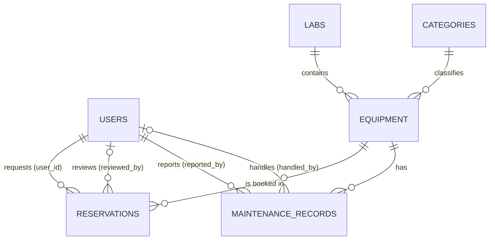

# Campus Equipment & Lab Instrument Reservation with Maintenance Ledger

A local web application for a college to catalogue lab equipment, take and review reservation
requests for time slots, and keep a permanent maintenance history for every instrument.

**Stack:** Python 3.10+ · Flask · MySQL 8.0+ · `mysql-connector-python` · Jinja templates · plain HTML/CSS.

---

## 1. Setup

### Prerequisites

| Tool | Version | Check |
|------|---------|-------|
| Python | 3.10 or newer | `python3 --version` (macOS) / `py --version` (Windows) |
| MySQL Server | 8.0.16 or newer (needed for `CHECK` constraints); tested on 8.4 | `mysql --version` |

### Steps

**1. Create a virtual environment and install dependencies**

macOS / Linux:
```bash
python3 -m venv .venv
source .venv/bin/activate
pip install -r requirements.txt
```

Windows (PowerShell):
```powershell
py -m venv .venv
.venv\Scripts\Activate.ps1
pip install -r requirements.txt
```

**2. Configure the environment**

macOS: `cp .env.example .env` · Windows: `copy .env.example .env`

Edit `.env` and set `DB_PASSWORD` to your MySQL root (or other user) password and `SECRET_KEY` to any long random
string, for example the output of `python -c "import secrets; print(secrets.token_hex(32))"`.

**3. Make sure MySQL is running**

- macOS (official installer): System Settings → MySQL → *Start MySQL Server*. With Homebrew: `brew services start mysql`.
- Windows: the installer registers a service named `MySQL80` (or similar); start it from *Services* or run `net start MySQL80` as administrator.

**4. Create the database and tables** (this also creates the `campus_equipment` database)

macOS:
```bash
mysql -u root -p < schema.sql
```
Windows (PowerShell does not support `<`, so use `cmd` or `source`):
```powershell
cmd /c "mysql -u root -p < schema.sql"
```
You can also open `schema.sql` in MySQL Workbench and run it.

**5. Load demo data**
```bash
python seed.py
```
Running it again does nothing if users already exist. To reset everything, repeat step 4, then step 5.

**6. Start the app**
```bash
flask --app app run
```
Open <http://127.0.0.1:5000>.

### Demo accounts (local demonstration only)

| Role | Email | Password |
|------|-------|----------|
| Admin | `admin@campus.test` | `admin12345` |
| Lab staff | `staff@campus.test` | `staff12345` |
| Lab staff | `meera.staff@campus.test` | `staff12345` |
| Student | `student@campus.test` | `student12345` |
| Student | `nina@campus.test` | `student12345` |
| Student | `karan@campus.test` | `student12345` |

Every page has a **For demo** toggle with a short presenter note about what that page shows and which
rule it demonstrates; on the login page it also gives one-click logins for the three roles.

Passwords are stored as Werkzeug hashes even for these accounts. Public registration always creates a **student**;
staff and admin accounts only come from `seed.py` (or an admin inserting them directly in MySQL).

### Running the tests
```bash
python -m unittest discover tests
```
These test the pure rules (time-slot validation, maintenance status order, `reports.sql` parsing) and need no database.

### Common errors

| Message | Cause and fix |
|---------|---------------|
| `Can't connect to MySQL server on 'localhost'` / error 2003 | MySQL is not running, or `DB_HOST`/`DB_PORT` is wrong. Start the server (step 3). |
| `Access denied for user 'root'@'localhost'` / error 1045 | Wrong `DB_PASSWORD` in `.env`. |
| `Unknown database 'campus_equipment'` / error 1049 | `schema.sql` has not been imported (step 4), or `DB_NAME` differs. |
| `Table 'campus_equipment.users' doesn't exist` | Same: import `schema.sql`. |
| `The session is unavailable because no secret key was set` | `SECRET_KEY` missing from `.env`. |
| `ModuleNotFoundError: No module named 'flask'` | The virtual environment is not activated, or step 1 was skipped. |
| `Authentication plugin 'caching_sha2_password' is not supported` | An old connector is installed. Run `pip install -r requirements.txt` inside the venv. |
| Seed says "skipping seed" | Data already exists. Re-import `schema.sql` to start fresh. |
| Times look wrong | Times are stored as local `DATETIME`; run MySQL and the app on the same machine and time zone. |

---

## 2. Files

| File | Purpose |
|------|---------|
| `app.py` | All Flask routes, role checks, booking rules and the approval transaction. |
| `db.py` | Reads `.env` and opens a MySQL connection (shared by `app.py` and `seed.py`). |
| `schema.sql` | Creates the database and the six tables with keys, constraints and indexes. |
| `seed.py` | Inserts fictional demo users, labs, categories, equipment, reservations and maintenance records. |
| `reports.sql` | Report queries. The Reports page runs these exact queries, and the file also runs in the `mysql` client. |
| `templates/` | Jinja pages: `base` layout, login/register, dashboard, equipment list/detail/form, reservations, maintenance, admin, reports, error. |
| `static/style.css` | All styling (no external CSS or fonts). |
| `tests/test_rules.py` | `unittest` tests for the pure validation rules. |
| `.env.example` | Template for local configuration. The real `.env` is git-ignored. |

---

## 3. Features by role

| | Student | Lab staff | Admin |
|---|:-:|:-:|:-:|
| Register / log in / log out | ✓ | ✓ | ✓ |
| Browse, search, filter equipment; view detail and maintenance history | ✓ | ✓ | ✓ |
| Request a reservation, view own requests, cancel own pending/approved | ✓ | ✓ | ✓ |
| Approve / reject pending requests (never their own) | | ✓ | ✓ |
| Mark ended reservations completed; cancel affected bookings | | ✓ | ✓ |
| Report maintenance issues, move records open → in progress → resolved | | ✓ | ✓ |
| Reports page | | ✓ | ✓ |
| Add/edit/retire equipment; add labs and categories | | | ✓ |

Every restriction is checked on the server by the `require(...)` decorator in `app.py`. Hiding a button is not
what protects an action: a student POSTing directly to `/reservations/1/approve` gets **403 Forbidden**.

### Booking rules and where they are enforced

| Rule | Python (`app.py`) | MySQL |
|------|-------------------|-------|
| End time later than start time | `validate_slot` | `CHECK (end_time > start_time)` |
| Only future slots | `validate_slot` (at request **and** approval) | |
| Retired equipment cannot be booked | `booking_problem` | `status ENUM('active','retired')` |
| Unresolved maintenance blocks booking/approval | `booking_problem` | |
| No two overlapping **approved** bookings | `booking_problem` at request **and** approval | overlap query + `SELECT … FOR UPDATE` lock |
| Pending requests are not bookings | overlap query filters `status = 'approved'` | |
| Nobody reviews their own request | `reservation_approve` / `reservation_reject` | |

Overlap test: `existing.start_time < requested.end_time AND existing.end_time > requested.start_time`.
A slot that starts exactly when another ends does **not** overlap.

**Approval transaction** (`reservation_approve`): `START TRANSACTION` → lock the reservation row (`FOR UPDATE`) →
lock the equipment row (`FOR UPDATE`) → re-run every check → `UPDATE … status='approved'` → `COMMIT`
(or `ROLLBACK` if any check fails). Because the equipment row is locked, a second staff member approving an overlapping
request for the same item waits until the first transaction commits, then sees the new approved booking and is refused.

**Maintenance warning:** reporting an issue for an item with upcoming approved reservations shows a warning and
opens the item's page, where staff can cancel the affected bookings. Nothing is deleted automatically.

---

## 4. Database design

### Entities and attributes (PK **bold**, FK *italic*)

- **users** (**user_id**, name, email UNIQUE, password_hash, department, role, created_at)
- **labs** (**lab_id**, lab_name, building, room_no), with UNIQUE (building, room_no)
- **categories** (**category_id**, category_name UNIQUE)
- **equipment** (**equipment_id**, asset_tag UNIQUE, equipment_name, *category_id*, *lab_id*, details, purchase_date, status)
- **reservations** (**reservation_id**, *equipment_id*, *user_id*, start_time, end_time, purpose, status, *reviewed_by* NULL, created_at)
- **maintenance_records** (**maintenance_id**, *equipment_id*, *reported_by*, issue, action_taken NULL, status, *handled_by* NULL, reported_at, resolved_at NULL)

### Foreign keys

| Foreign key | References | Null? | On delete |
|-------------|-----------|-------|-----------|
| equipment.category_id | categories.category_id | NOT NULL | RESTRICT |
| equipment.lab_id | labs.lab_id | NOT NULL | RESTRICT |
| reservations.equipment_id | equipment.equipment_id | NOT NULL | RESTRICT |
| reservations.user_id | users.user_id | NOT NULL | RESTRICT |
| reservations.reviewed_by | users.user_id | NULL until reviewed | RESTRICT |
| maintenance_records.equipment_id | equipment.equipment_id | NOT NULL | RESTRICT |
| maintenance_records.reported_by | users.user_id | NOT NULL | RESTRICT |
| maintenance_records.handled_by | users.user_id | NULL until someone handles it | RESTRICT |

`RESTRICT` everywhere is deliberate: MySQL refuses to delete a user, lab, category or equipment item that history
refers to. Equipment is **retired** (`status = 'retired'`) instead of deleted, and the app has no delete actions.

### Relationships and cardinality (all one-to-many)

| Relationship | Cardinality | Participation |
|--------------|-------------|---------------|
| User **requests** Reservation | 1 : N | each reservation has exactly one requester (total); a user may have none |
| User **reviews** Reservation | 1 : N | optional on the reservation side (`reviewed_by` NULL while pending/cancelled) |
| Lab **contains** Equipment | 1 : N | each item is in exactly one lab |
| Category **classifies** Equipment | 1 : N | each item has exactly one category |
| Equipment **has** Reservation | 1 : N | each reservation is for exactly one item |
| Equipment **has** Maintenance record | 1 : N | each record is for exactly one item |
| User **reports** Maintenance record | 1 : N | each record has exactly one reporter |
| User **handles** Maintenance record | 1 : N | optional (`handled_by` NULL until work starts) |


(GitHub and VS Code render this block as a diagram. When drawing by hand, use one box per table and one line per row of the table above.)

### EER: specialization of User

Conceptually, **User** is specialized into **Student**, **Lab Staff** and **Admin**. The specialization is
**disjoint** (an account has exactly one role) and **total** (every account has a role), with `role` as the
defining attribute. The subclasses have no attributes of their own; they differ only in what they may do. So
they are mapped to the single `users` table with an `ENUM` `role` column (the "single table" mapping) and no
extra tables. If a subclass later needed its own data (e.g. a student's roll number), that subclass would get a
1:1 table keyed by `user_id`.

### Why the schema is in 3NF

- **1NF:** every column holds one atomic value; there are no repeating groups (each reservation and each
  maintenance event is its own row instead of a list inside the equipment row).
- **2NF:** every table has a single-column surrogate primary key, so no attribute can depend on part of a key.
- **3NF:** no non-key attribute depends on another non-key attribute. Lab name/building/room live only in `labs`,
  category names only in `categories`, user names only in `users`; other tables store just the foreign key.
  The other candidate keys (`users.email`, `equipment.asset_tag`, `labs(building, room_no)`,
  `categories.category_name`) are declared `UNIQUE`, so each table's determinants are all keys (also BCNF).
- `department` is a plain attribute of a user. It would become its own table only if departments had their own
  data (head, building) to avoid repeating.

### Availability is derived, not stored

There is no `is_available` column. An item can be booked for a slot when all three hold:

1. `equipment.status = 'active'`
2. no `maintenance_records` row for it has `status <> 'resolved'`
3. no `reservations` row for it is `approved` and overlaps the slot

`booking_problem()` in `app.py` runs these three queries. The catalogue shows "under maintenance" / "in use now"
with `EXISTS` subqueries over the same tables. A stored flag could disagree with the real records; a derived
answer cannot.

### Other constraints worth pointing out

- `CHECK ((status = 'resolved') = (resolved_at IS NOT NULL))`: a maintenance record has a resolution date exactly when it is resolved.
- `ENUM` columns restrict `role` and all `status` values.
- Index `(equipment_id, status, start_time, end_time)` on `reservations` serves the overlap query; `(equipment_id, status)` on `maintenance_records` serves the unresolved-issue check.
- History is append-only in practice: reject/cancel/complete change `status`, maintenance moves forward only (`maintenance_step_allowed`), and resolving keeps the original `issue`.

### SQL concepts shown, and where

| Concept | Where |
|---------|-------|
| PK, FK, UNIQUE, NOT NULL, CHECK, ENUM | `schema.sql` |
| INSERT / SELECT / UPDATE (CRUD; delete is intentionally replaced by status changes) | `app.py` |
| WHERE, LIKE search, ORDER BY, LIMIT | equipment catalogue, `reports.sql` |
| INNER JOIN | almost every list page, `reports.sql` |
| LEFT JOIN | reviewer/handler names (nullable FKs), `most_reserved`, admin item counts |
| GROUP BY, COUNT, SUM, MIN, MAX, conditional aggregation | `reports.sql`, admin page |
| Subqueries / EXISTS | `under_maintenance` report, catalogue status, dashboard counts |
| Transaction + row locking | `reservation_approve`, `seed.py` |
| Parameterized SQL | every query (`%s` placeholders); no user input is ever formatted into SQL text |

---

## 5. Manual test checklist

Run with fresh demo data (re-import `schema.sql`, then `python seed.py`).

- [ ] **Register & login:** register a new student. Log in. The role badge says *student*. A wrong password shows "Invalid email or password".
- [ ] **Role restrictions:** as a student, open `/admin`, `/maintenance`, `/reports`, `/equipment/new`: each shows *Error 403*. As staff, `/admin` is 403.
- [ ] **Equipment:** as admin, add a lab, a category and an item. Adding the same asset tag twice is refused. Search "OSC" and filter by lab.
- [ ] **Valid request:** as `student@campus.test`, open *Digital Multimeter* and request a slot tomorrow. It appears under *My requests* as *pending*.
- [ ] **Invalid time:** request with end before start → "end time must be later". A past slot → "future time slot".
- [ ] **Overlap:** request *PHY-OSC-001* overlapping Sam's approved booking (in 2 days, 10:00–12:00) → refused. As staff, approve Nina's seeded pending request for the same item → refused with the overlap message.
- [ ] **Maintenance block:** *DC Power Supply* (open issue) and *He-Ne Laser Kit* (in progress) show "under maintenance" and have no booking form.
- [ ] **Approve / reject / cancel / complete:** as staff, approve Nina's *PHY-OSC-002* request, reject Karan's GPU request. As a student, cancel your own pending request. A staff member's own request shows "Your request" with no approve button. After an approved booking's end time passes, *Mark returned* sets it to *completed*.
- [ ] **Maintenance ledger:** report an issue on *PHY-OSC-001* and see the warning about its upcoming approved booking. Move the record to *in progress*, then *resolved* with an action. The issue text is kept and the resolved date appears. The item becomes bookable again.
- [ ] **History preserved:** rejected/cancelled/completed reservations still appear under *My requests* and in *Reports*. Retire an item from its edit page: it stays in the catalogue as *retired* with its history, and cannot be booked.
