<!--
  Campus Equipment & Lab Instrument Reservation with Maintenance Ledger — DBMS Study Guide
  Editable source. Build the PDF with:  python study_guide_build/build_guide.py
  Conventions: <div class="callout note|key|warn|limit" markdown="1"> boxes, figures point at diagrams/*.svg,
  every chapter starts with a level-1 heading (the build script turns those into the table of contents).
-->

# Project Overview {#ch-overview}

## What problem does the project solve? {#sec-problem}

In many colleges, laboratory equipment is managed with paper registers, spreadsheets and messages on group chats.
That causes five recurring problems:

| Problem with manual management | What actually goes wrong | How this system addresses it |
|---|---|---|
| **Booking conflicts** | Two people are promised the same oscilloscope for the same hour. | Approved reservations for one item can never overlap. The rule is checked when a request is made **and** again, inside a locked transaction, when staff approve it. |
| **Unclear availability** | A student cannot tell whether an item is free, broken or retired. | The catalogue shows each item's status (*available*, *in use now*, *under maintenance*, *retired*). It is calculated live from the database. |
| **Poor instrument tracking** | Items with the same name are confused; nobody knows which room they are in. | Every physical item has its own row and a unique `asset_tag`, linked to exactly one lab and one category. |
| **Lost repair history** | Repairs are remembered informally and forgotten when staff change. | Every incident is a new row in `maintenance_records` that is never deleted. Resolving it adds the action taken and a date without erasing the issue. |
| **Unmonitored requests** | Requests sit in someone's inbox. | Staff see a *Pending requests* table with the requester, slot and purpose, plus dashboard counts and a *Pending requests* report. |

**A typical example (as implemented).** Sam, a student, opens the *Digital Oscilloscope PHY-OSC-001* page and
requests 10:00–12:00 two days from now. The application checks four things: the times are valid and in the
future, the item is active, it has no unresolved maintenance record, and no **approved** booking overlaps that
slot. If all pass, it stores the request with status `pending`. Later a lab staff member opens *Reservations*
and clicks **Approve**. The application then repeats the checks inside a database transaction that locks the
equipment row. Only if they still pass does it change the status to `approved` and record who reviewed it.

## Project objectives {#sec-objectives}

<div class="two-col" markdown="1">
<div class="callout key" markdown="1">
**Practical goals (for the college)**

- One place to find equipment and its lab location.
- A request → review → approval workflow for time slots.
- Guaranteed absence of double bookings.
- Broken equipment automatically becomes unbookable.
- A permanent repair ledger per instrument.
- Simple inventory administration without losing history.
</div>
<div class="callout note" markdown="1">
**DBMS learning goals (for the course)**

- Design a normalised schema (3NF) with six related tables.
- Use PK, FK, `UNIQUE`, `NOT NULL`, `CHECK`, `DEFAULT`, `ENUM`.
- Write joins, aggregates, subqueries and `EXISTS`.
- Use a **transaction** with row locking for approvals.
- Derive availability instead of storing a redundant flag.
- Access MySQL safely from Python with parameterised SQL.
</div>
</div>

## Actors and permissions {#sec-actors}

The system has three roles, stored in `users.role`. Anyone who registers through the web page becomes a
`student`. The `lab_staff` and `admin` accounts are created only by `seed.py`, or by inserting rows directly in MySQL.

| Functionality | Student | Lab staff | Admin |
|---|:-:|:-:|:-:|
| Register (always as student), log in, log out | ✓ | ✓ | ✓ |
| Browse, search and filter the equipment catalogue | ✓ | ✓ | ✓ |
| View an item's details, upcoming approved bookings, maintenance history | ✓ | ✓ | ✓ |
| Request a reservation; view own requests | ✓ | ✓ | ✓ |
| Cancel **own** pending/approved reservation (before it ends) | ✓ | ✓ | ✓ |
| Cancel **another user's** pending/approved reservation | | ✓ | ✓ |
| Approve / reject pending requests (**never their own**) | | ✓ | ✓ |
| Mark an ended approved reservation as completed (*Mark returned*) | | ✓ | ✓ |
| Report maintenance issues; move records open → in progress → resolved | | ✓ | ✓ |
| Maintenance ledger page and Reports page | | ✓ | ✓ |
| Add / edit / retire equipment; add labs and categories | | | ✓ |

<div class="callout warn" markdown="1">
**Permissions are enforced on the server.** Each protected route is wrapped in the `require(...)` decorator in
`app.py`. A student who types `/reservations/1/approve` into a tool that sends a POST gets **403 Forbidden**,
even though the page never shows them an *Approve* button.
</div>

## Core features and how they work together {#sec-features}

<div class="feature-grid" markdown="1">
<div class="feature f-equipment" markdown="1">
**Equipment inventory**<br>
Catalogue with search (name or asset tag) and lab/category filters. Detail page per item. Admins add, edit and
retire items. Nothing is ever deleted.
</div>
<div class="feature f-reservations" markdown="1">
**Reservation workflow**<br>
`pending` → `approved` / `rejected` / `cancelled`, then `approved` → `completed` or `cancelled`. Every request
stays in the table as history.
</div>
<div class="feature f-maintenance" markdown="1">
**Maintenance ledger**<br>
One row per incident: `open` → `in_progress` → `resolved`. While a record is unresolved, the item cannot be newly
booked or approved.
</div>
<div class="feature f-users" markdown="1">
**Dashboard & reports**<br>
Role-specific summary counts. Six reports built from `reports.sql` use joins, `GROUP BY`, `COUNT`/`SUM` and `EXISTS`.
</div>
</div>

The three parts meet at the **equipment** row. A reservation can be approved only if the equipment is `active`,
has no unresolved maintenance record, and has no overlapping approved reservation. Equipment availability is
therefore *derived from the other two tables* instead of being stored as a column (Chapter 4).

# Technologies and Tools Used {#ch-tech}

All versions below were read from `requirements.txt` or observed in the development environment
(`pip show`, `mysql --version`).

| Technology | What it is | Why this project uses it | Where it is used |
|---|---|---|---|
| **Python 3** (3.11.9 used; README asks for 3.10+) | General-purpose programming language | Readable language that every team member already knows | `app.py`, `db.py`, `seed.py`, `tests/` |
| **Flask 3.1.2** | Lightweight web framework | Maps URLs to Python functions and handles requests, sessions, redirects and flash messages, with no heavy structure | `app.py` (every `@app.route`, `session`, `flash`, `g`) |
| **Jinja2 3.1.6** (bundled with Flask) | Template engine | Fills HTML pages with database results using loops and conditions | `templates/*.html`, called through `render_template()` |
| **Werkzeug 3.1.9** (bundled with Flask) | Flask's underlying toolkit | Supplies `generate_password_hash` / `check_password_hash` (scrypt hashes) | `app.py` (`register`, `login`), `seed.py` |
| **MySQL Server 8** (8.4.6 tested; 8.0.16+ needed for `CHECK`) | Relational database (InnoDB engine) | Stores all data; enforces keys, constraints and row locks | `schema.sql`, `reports.sql`, every query |
| **mysql-connector-python 9.4.0** | Oracle's official MySQL driver for Python | Opens connections, runs parameterised SQL, returns rows as dictionaries | `db.py` (`get_connection`), cursors in `app.py`/`seed.py` |
| **python-dotenv 1.1.1** | Reads a `.env` file into environment variables | Keeps the DB password and `SECRET_KEY` out of the code | `db.py` (`load_dotenv()`) |
| **HTML5 + CSS** | Page structure and styling | Plain, framework-free UI: forms, tables, badges; responsive layout via media queries | `templates/`, `static/style.css` |
| **JavaScript** (one attribute only) | — | `onchange="this.form.submit()"` auto-submits the maintenance status filter; a `<noscript>` button covers browsers without JS | `templates/maintenance.html` |
| **unittest** (Python standard library) | Testing framework | Tests the pure rule functions without needing a database | `tests/test_rules.py` |

<div class="callout note" markdown="1">
**Not used** (despite sometimes appearing in similar projects): SQLAlchemy or any ORM, React or other JS
frameworks, Django, Docker, stored procedures, triggers or views. Every SQL statement is written by hand.
</div>

## Architecture {#sec-architecture}

<figure>
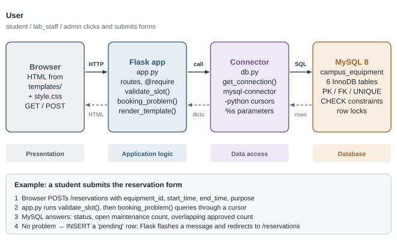
<figcaption>Figure 2.1. Request path from the user's browser to MySQL and back. Solid arrows are requests; dashed arrows are results.</figcaption>
</figure>

| Layer | Responsibility in this project | Files |
|---|---|---|
| **Presentation** | Shows pages and collects input. Contains no rules and talks to the server only through GET/POST requests. | `templates/*.html`, `static/style.css` |
| **Application / business logic** | Decides *who* may do *what* and checks booking and maintenance rules. Runs SQL and chooses which page or redirect to return. | `app.py` |
| **Data access** | Creates the MySQL connection from `.env` settings. The connector sends SQL with bound parameters and returns rows. | `db.py` + mysql-connector-python |
| **Database** | Stores data permanently and guarantees integrity (keys, constraints), atomic transactions and row locks. | MySQL, `schema.sql` |

**What happens when a reservation form is submitted?** The browser sends `POST /reservations` with four form
fields. Flask calls `reservation_create()`. It uses `parse_datetime()` to turn the times into Python `datetime`
values, then calls `validate_slot()` and `booking_problem()`; the latter runs three `SELECT` queries. If every
check passes, it runs an `INSERT` with the status defaulting to `pending`. Flask then stores a *flash* message in
the session and replies **302 redirect** to `/reservations`. The browser follows the redirect with a `GET`, and
that page shows the message along with the new request.

# Understanding the Project Structure {#ch-structure}

```text
DBMS/                          (project root)
├── app.py                     Flask application: every route, rule and query (≈630 lines)
├── db.py                      get_connection(): reads .env, connects to MySQL
├── schema.sql                 creates database campus_equipment and its 6 tables
├── seed.py                    inserts fictional demo data (skips if users exist)
├── reports.sql                6 named report queries (also runnable in the mysql client)
├── requirements.txt           Flask, mysql-connector-python, python-dotenv (pinned)
├── .env.example               template for .env (DB_* settings and SECRET_KEY)
├── .gitignore                 keeps .env, .venv/ and caches out of git
├── README.md                  setup, design notes, manual test checklist
├── FEASIBILITY.md             feasibility report
├── templates/                 12 Jinja pages (base, login, register, dashboard, equipment,
│                              equipment_detail, equipment_form, reservations, maintenance,
│                              admin, reports, error)
├── static/style.css           all styling, no external assets
└── tests/test_rules.py        7 unittest tests for pure functions
```

| File | Purpose and why it exists | Used by | If it were missing |
|---|---|---|---|
| `app.py` | The whole web application: routes, access control, validation, SQL, transaction | `flask --app app run`; `tests` import its pure functions | Nothing runs |
| `db.py` | One place that builds a connection from environment variables, shared by the app and the seed script | `app.py` (`db()`), `seed.py` | Both would duplicate connection code; import error now |
| `schema.sql` | The authoritative table definitions and constraints | Run once by the user in the `mysql` client | No tables: every page shows the database-error page |
| `seed.py` | Repeatable demo data with hashed passwords | Run once by the user | The app works but is empty; no staff/admin accounts exist |
| `reports.sql` | Single source of report SQL; `load_reports()` splits it at `-- name:` lines | `/reports` route; also the mysql client | Reports page crashes (`FileNotFoundError`); one unit test fails |
| `templates/` | The HTML for every page; `base.html` holds the nav bar and flash messages, the others extend it | `render_template()` | `TemplateNotFound` error |
| `static/style.css` | Visual design | `base.html` `<link>` | Pages work but are unstyled |
| `.env` (you create it) | Real credentials and secret key | `load_dotenv()` in `db.py` | Defaults are used: root with empty password; no `SECRET_KEY`, so login fails |
| `tests/test_rules.py` | Guards the pure rules | `python -m unittest discover tests` | Rules could break silently |

<figure>
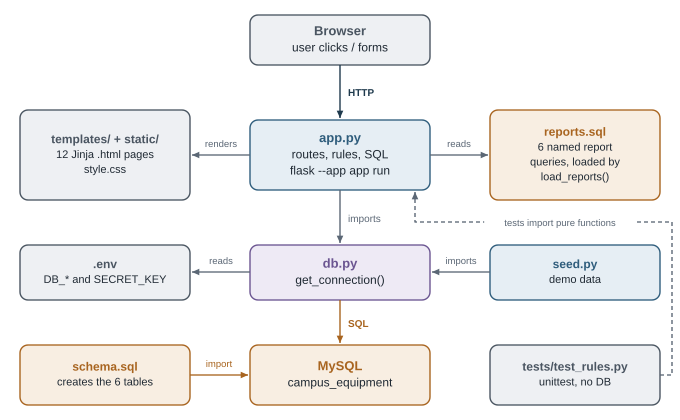
<figcaption>Figure 3.1. How the files relate at run time. Orange = SQL/MySQL, blue = Python, grey = support files.</figcaption>
</figure>

# Database Design and SQL Schema {#ch-database}

`schema.sql` creates the database `campus_equipment` and six InnoDB tables. It first drops them in reverse
dependency order (children before parents) so the file can be re-run. **Re-running it deletes all data.**

<div class="callout note" markdown="1">
**Key words used below.** *PK* = primary key, *FK* = foreign key, *UQ* = unique, *NN* = `NOT NULL`,
*N* = nullable. A *candidate key* is any column set that could serve as the primary key because it is unique and
never null. This schema uses short integer **surrogate** keys (`AUTO_INCREMENT`) as primary keys and declares
the natural candidate keys as `UNIQUE`.
</div>

## Table `users` {#sec-users}

| Column | Data type | Key / constraint | Purpose |
|---|---|---|---|
| `user_id` | `INT AUTO_INCREMENT` | **PK** | Identifies one account |
| `name` | `VARCHAR(100)` | NN | Display name |
| `email` | `VARCHAR(120)` | NN, **UNIQUE** | Login identifier; candidate key |
| `password_hash` | `VARCHAR(255)` | NN | Werkzeug scrypt hash, never the password itself (162 characters in practice) |
| `department` | `VARCHAR(100)` | NN | The user's department (plain attribute) |
| `role` | `ENUM('student', 'lab_staff', 'admin')` | NN, `DEFAULT 'student'` | Decides permissions |
| `created_at` | `DATETIME` | NN, `DEFAULT CURRENT_TIMESTAMP` | When the account was made |

Candidate keys: `user_id`, `email`. The `ENUM` rejects any other role: inserting `'superuser'` failed with
*error 1265, data truncated* during testing.

## Table `labs` {#sec-labs}

| Column | Data type | Key / constraint | Purpose |
|---|---|---|---|
| `lab_id` | `INT AUTO_INCREMENT` | **PK** | Identifies one laboratory |
| `lab_name` | `VARCHAR(100)` | NN | e.g. *Physics Lab 1* |
| `building` | `VARCHAR(100)` | NN, part of `uq_lab_location` | e.g. *Science Block* |
| `room_no` | `VARCHAR(20)` | NN, part of `uq_lab_location` | e.g. *S-101* |

`UNIQUE KEY uq_lab_location (building, room_no)` is a **composite** candidate key: no two labs can occupy the same
room. `lab_name` alone is *not* unique (two buildings could each have a "Physics Lab").

## Table `categories` {#sec-categories}

| Column | Data type | Key / constraint | Purpose |
|---|---|---|---|
| `category_id` | `INT AUTO_INCREMENT` | **PK** | Identifies one category |
| `category_name` | `VARCHAR(100)` | NN, **UNIQUE** | e.g. *Measuring Instruments*; candidate key |

## Table `equipment` {#sec-equipment}

| Column | Data type | Key / constraint | Purpose |
|---|---|---|---|
| `equipment_id` | `INT AUTO_INCREMENT` | **PK** | Identifies one *physical* item |
| `asset_tag` | `VARCHAR(30)` | NN, **UNIQUE** | Label stuck on the item; candidate key |
| `equipment_name` | `VARCHAR(150)` | NN, indexed (`idx_equipment_name`) | Model name. **Not** unique: two oscilloscopes share a name |
| `category_id` | `INT` | NN, **FK → categories**, `ON DELETE RESTRICT` | What kind of item it is |
| `lab_id` | `INT` | NN, **FK → labs**, `ON DELETE RESTRICT` | Where it is kept |
| `details` | `TEXT` | N | Optional description |
| `purchase_date` | `DATE` | N | Optional |
| `status` | `ENUM('active', 'retired')` | NN, `DEFAULT 'active'` | Lifecycle state. *Retired* items stay for history but cannot be booked |

## Table `reservations` {#sec-reservations}

| Column | Data type | Key / constraint | Purpose |
|---|---|---|---|
| `reservation_id` | `INT AUTO_INCREMENT` | **PK** | Identifies one request |
| `equipment_id` | `INT` | NN, **FK → equipment**, RESTRICT | Which item is requested |
| `user_id` | `INT` | NN, **FK → users**, RESTRICT | Who requested it (the requester) |
| `start_time` | `DATETIME` | NN | Slot start |
| `end_time` | `DATETIME` | NN, `CHECK (end_time > start_time)` | Slot end |
| `purpose` | `VARCHAR(255)` | NN | Short reason (the app trims it to 255 characters) |
| `status` | `ENUM('pending', 'approved', 'rejected', 'cancelled', 'completed')` | NN, `DEFAULT 'pending'` | Workflow state |
| `reviewed_by` | `INT` | **N**, **FK → users**, RESTRICT | Staff member who approved or rejected. NULL while pending, or when cancelled before review |
| `created_at` | `DATETIME` | NN, `DEFAULT CURRENT_TIMESTAMP` | When the request was made |

Constraint `chk_reservation_time` makes MySQL itself refuse a backwards time range. This was confirmed in testing
with *error 3819, check constraint violated*. Index `idx_reservation_slot (equipment_id, status, start_time, end_time)`
matches the overlap query's `WHERE` clause. Because `equipment_id` is its first column, it also serves the foreign key.

## Table `maintenance_records` {#sec-maintenance}

| Column | Data type | Key / constraint | Purpose |
|---|---|---|---|
| `maintenance_id` | `INT AUTO_INCREMENT` | **PK** | Identifies one incident |
| `equipment_id` | `INT` | NN, **FK → equipment**, RESTRICT | Which item has the problem |
| `reported_by` | `INT` | NN, **FK → users**, RESTRICT | Who reported it |
| `issue` | `TEXT` | NN | Description of the problem. Never overwritten by the app |
| `action_taken` | `TEXT` | N | Repair notes; required by the app before resolving |
| `status` | `ENUM('open', 'in_progress', 'resolved')` | NN, `DEFAULT 'open'` | Incident state |
| `handled_by` | `INT` | **N**, **FK → users**, RESTRICT | Staff member who made the latest update. NULL until someone handles it |
| `reported_at` | `DATETIME` | NN, `DEFAULT CURRENT_TIMESTAMP` | When reported |
| `resolved_at` | `DATETIME` | N | When resolved |

`CONSTRAINT chk_resolved_at CHECK ((status = 'resolved') = (resolved_at IS NOT NULL))` compares two true/false
values. A record has a resolution date **if and only if** it is resolved. Index `idx_maintenance_status (equipment_id, status)`
serves the "unresolved maintenance for this item" check.

## Primary keys vs foreign keys, in this project {#sec-pkfk}

<div class="two-col" markdown="1">
<div class="callout key" markdown="1">
**Primary key**: uniquely identifies a row *in its own table*.
`equipment.equipment_id = 1` is exactly one physical oscilloscope (asset tag `PHY-OSC-001`).
It can never be NULL or duplicated.
</div>
<div class="callout note" markdown="1">
**Foreign key**: a column whose value must exist as a primary key *in another table*.
`reservations.equipment_id = 1` means "this request is for equipment 1". MySQL rejects a reservation for
equipment 999 if that item does not exist.
</div>
</div>

**Deliberate deletion behaviour.** All eight foreign keys use `ON DELETE RESTRICT`. MySQL refuses to delete a
lab, category, user or equipment item while any row refers to it. Both cases were confirmed in testing:
deleting equipment 1 and deleting lab 1 each failed with *error 1451*. History therefore cannot be destroyed
by accident. The application offers **no delete actions at all**: equipment is retired by changing `status`,
and reservations are closed by changing their `status`.

**Indexes.** Every PK and `UNIQUE` constraint creates an index automatically. InnoDB also creates an index for each
foreign-key column that lacks one; `SHOW INDEX FROM reservations` lists `user_id` and `reviewed_by`. The schema adds
three indexes of its own: `idx_equipment_name`, `idx_reservation_slot` and `idx_maintenance_status`.

## Normalisation {#sec-normalisation}

Normalisation organises columns so that each fact is stored once. That avoids *update anomalies*, where one copy
is changed and another is forgotten.

| Normal form | Principle (plain words) | How this schema meets it |
|---|---|---|
| **1NF** | Every cell holds one atomic value; no repeating groups or lists. | Each reservation and each maintenance event is its **own row**. There is no "list of bookings" column inside `equipment`, and every column holds one value. |
| **2NF** | 1NF + no non-key column depends on only **part** of a composite primary key. | Every table's PK is a single column (`*_id`), so a partial dependency is impossible. |
| **3NF** | 2NF + no non-key column depends on **another non-key column** (no transitive dependency). | See the dependency check below. |

**Dependency check per table** (→ means "determines"):

- `users`: `user_id → name, email, password_hash, department, role, created_at`. `email` determines the same
  things, but `email` is itself a key (UNIQUE NOT NULL), so it is not a transitive dependency.
- `labs`: `lab_id → lab_name, building, room_no`, and `(building, room_no) → lab_id, lab_name`. Both are keys.
- `categories`: only `category_id → category_name`.
- `equipment`: `equipment_id → all columns`; `asset_tag` is a key. The lab's name and the category's name are
  **not** stored here, only `lab_id` and `category_id`.
- `reservations`, `maintenance_records`: the surrogate key determines everything. No non-key column determines
  another one.

Every determinant is a candidate key, so the schema is also in **BCNF**.

<div class="callout warn" markdown="1">
**Why not store `lab_name` inside `equipment`?** If every equipment row repeated "Physics Lab 1, Science Block,
S-101", then `lab_id → lab_name` would be a **transitive dependency** (`equipment_id → lab_id → lab_name`).
Renaming the lab would mean updating many rows; missing one would leave contradictory data. Instead the name is
stored once in `labs` and fetched with a `JOIN` when needed.
</div>

**Honest notes on borderline cases.**

- `department` is a plain text attribute of `users`. Nothing in the project stores facts *about* departments
  (head, building), so there is no transitive dependency to remove. A `departments` table would only be needed if
  such facts were added.
- `resolved_at` is not derivable from `status`, because it records *when* resolution happened. The `CHECK`
  constraint only keeps the two consistent.
- `handled_by` holds the **latest** handler only. Earlier handlers are overwritten (see Limitations).
  This is a design simplification, not a normal-form violation.

## Stored vs derived information: availability {#sec-derived}

There is **no `is_available` column**. Whether an item can be booked for a slot is calculated from three facts
already stored elsewhere:

<div class="rule-box" markdown="1">
An item is bookable for `[start, end)` **if and only if**

1. `equipment.status = 'active'`, **and**
2. no row in `maintenance_records` for it has `status <> 'resolved'`, **and**
3. no row in `reservations` for it has `status = 'approved'` and overlaps the slot.
</div>

`booking_problem()` in `app.py` runs exactly these three checks. The catalogue's status badges use the same tables
through `EXISTS` subqueries: *under maintenance* means an unresolved record exists, and *in use now* means an approved
reservation covers `NOW()`. A stored flag would have to be updated by every approval, cancellation, completion,
repair and retirement. Forgetting one update would make the flag lie. A derived answer cannot disagree with the
records it is computed from.

The implication is that each availability check costs a few small queries. The two indexes
`idx_reservation_slot` and `idx_maintenance_status` keep those queries fast.

<div class="landscape" markdown="1">

# ER and EER Diagrams {#ch-er}

<figure class="er">
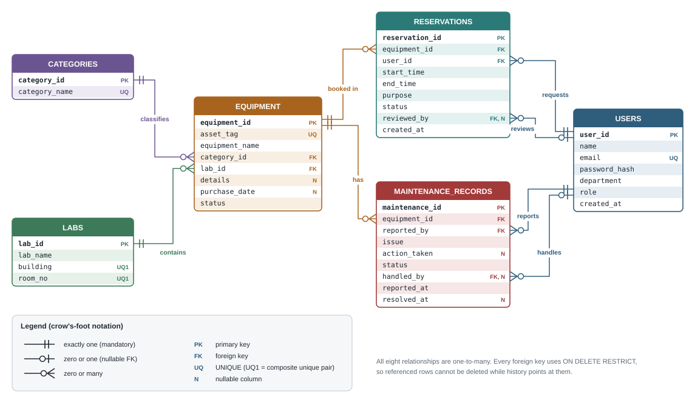
<figcaption>Figure 5.1. Complete ER diagram of the implemented schema in crow's-foot notation. Each line attaches to the foreign-key column it represents.</figcaption>
</figure>
</div>

## Reading the relationships {#sec-relationships}

| # | Relationship (parent → child) | Implemented by | Cardinality | Participation on the child side |
|---|---|---|---|---|
| 1 | Lab **contains** Equipment | `equipment.lab_id` | 1 : N | Mandatory: every item is in exactly one lab |
| 2 | Category **classifies** Equipment | `equipment.category_id` | 1 : N | Mandatory: exactly one category |
| 3 | Equipment **is booked in** Reservation | `reservations.equipment_id` | 1 : N | Mandatory: each request is for one item |
| 4 | Equipment **has** Maintenance record | `maintenance_records.equipment_id` | 1 : N | Mandatory |
| 5 | User **requests** Reservation | `reservations.user_id` | 1 : N | Mandatory: every request has a requester |
| 6 | User **reviews** Reservation | `reservations.reviewed_by` | 0..1 : N | **Optional**: NULL until approved/rejected |
| 7 | User **reports** Maintenance record | `maintenance_records.reported_by` | 1 : N | Mandatory |
| 8 | User **handles** Maintenance record | `maintenance_records.handled_by` | 0..1 : N | **Optional**: NULL until someone updates it |

On the parent side every relationship is "zero or many": a lab may be empty and a user may never book anything.
`users` and `reservations` are linked by **two different** relationships (requests, reviews), and so are `users`
and `maintenance_records` (reports, handles). Each relationship is a separate foreign-key column.

**To draw it yourself:** make one box per table with its PK first and FKs marked. Draw one line per row of the
table above, from the parent's PK to the child's FK column. Put a double bar (‖) at the parent end, or a circle and
bar (o|) for the two optional ones, and a circle and crow's foot (o<) at the child end.

## EER: specialisation of User {#sec-eer}

<figure>
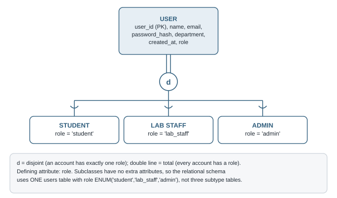
<figcaption>Figure 5.2. Conceptual specialisation of USER. It is a <b>conceptual</b> model only; MySQL has no subtype tables.</figcaption>
</figure>

Conceptually, **User** is a superclass with three subclasses: **Student**, **Lab Staff** and **Admin**.

- **Disjoint (d):** an account has exactly one role.
- **Total (double line):** every account has a role. `role` is `NOT NULL` with a default.
- **Defining attribute:** `role`.

**Conceptual model vs relational schema.** The subclasses do not have attributes of their own. They differ only in
*what they are allowed to do*, so the implemented schema maps the whole hierarchy to **one** `users` table with
an `ENUM` `role` column (the "single-table" mapping). There are **no** `students`, `lab_staff` or `admins`
tables. If a subclass later gained its own data, such as a student roll number, that subclass would get a 1:1
table keyed by `user_id`.

# How the Application Works, Step by Step {#ch-workflows}

## Workflow A: Registration and login {#sec-wf-login}

<figure>
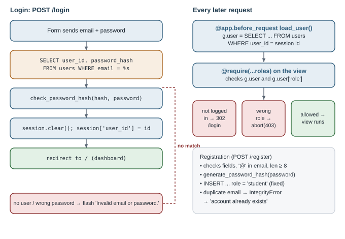
<figcaption>Figure 6.1. Login (left) and the check that runs on every later request (right). Blue = Python, orange = SQL.</figcaption>
</figure>

1. **Registration** (`register()`, `app.py:176`). The form posts `name`, `email`, `department` and `password`.
   Python trims the values and lower-cases the email. It then checks that every field is filled in, that the
   email contains `@` and that the password has at least 8 characters.
2. The password is turned into a one-way **hash** with `generate_password_hash(password)`, producing a string that
   starts `scrypt:32768:8:1$…`. The row is inserted with the role written as the literal `'student'` **inside the
   SQL**, so a crafted form field cannot choose `admin`. A duplicate email violates `UNIQUE`. MySQL raises
   `IntegrityError`, and the app shows "An account with that email already exists."
3. **Login** (`login()`, `app.py:163`). The app fetches `user_id, password_hash` by email. `check_password_hash(stored, typed)`
   hashes the typed password with the stored salt and settings, then compares the results. Hashing is **not encryption**:
   the password cannot be recovered from the hash, only checked against it.
4. **Session.** On success the app clears the session and sets `session["user_id"]`. Flask's session is a cookie
   **signed** with `SECRET_KEY`. The browser can see its contents but cannot change them without breaking the
   signature. `SESSION_COOKIE_SAMESITE = "Lax"` stops browsers from sending the cookie with form posts from other sites.
5. **Every later request.** `load_user()` (`@app.before_request`) reads `session["user_id"]` and loads that user into
   `g.user`. `require(*roles)` then either redirects to `/login` (not logged in), calls `abort(403)` (wrong role)
   or runs the page function.
6. **Logout** is a `POST /logout` that clears the session.

## Workflow B: Equipment discovery {#sec-wf-equipment}

<figure>
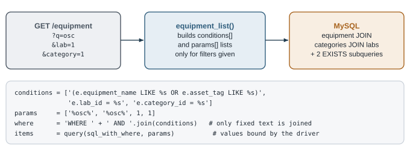
<figcaption>Figure 6.2. How search and filter values become a parameterised WHERE clause in <code>equipment_list()</code>.</figcaption>
</figure>

`GET /equipment` reads up to three optional query-string values: `q`, `lab` and `category`. For each value that is
present, it adds a fixed SQL fragment containing `%s` placeholders to a `conditions` list, and the value itself to
a `params` list. The fragments are joined with `AND`. The user's text never becomes part of the SQL string.
Lab and category names come from `JOIN`s, because `equipment` stores only their ids. Two `EXISTS` subqueries
compute the live status badges (Chapter 7).

`GET /equipment/<id>` (`equipment_detail()`) runs three queries:

- the item, joined with its lab and category;
- its upcoming approved reservations, joined with `users` for the requester's name;
- its full maintenance history, joined twice with `users` (reporter, and handler via `LEFT JOIN`).

The booking form appears only if the item is `active` and no history row is unresolved. This display rule is a
convenience only: the server repeats every check when the form is posted.

## Workflow C: Making and reviewing a reservation {#sec-wf-reservation}

<figure>
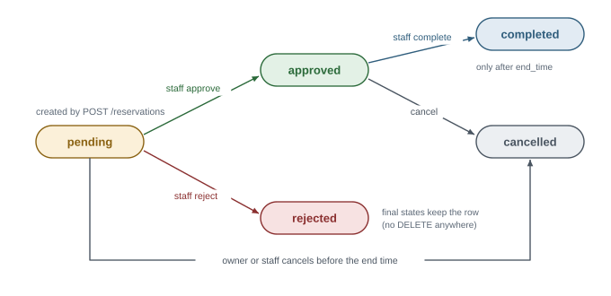
<figcaption>Figure 6.3. The five reservation states in <code>reservations.status</code> and the actions that change them.</figcaption>
</figure>

<figure>
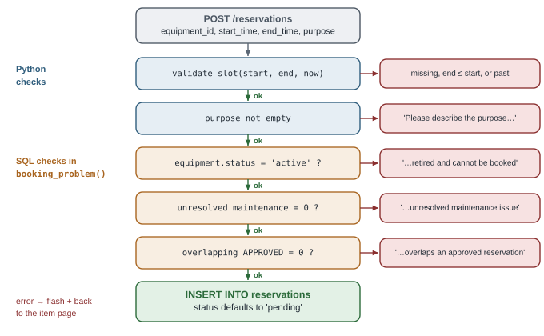
<figcaption>Figure 6.4. Checks made by <code>reservation_create()</code>, in order. The first failure is shown to the user and nothing is inserted.</figcaption>
</figure>

**Who can do what to a reservation** (all checks are in `app.py`):

| Action | Route | Allowed when | Database change |
|---|---|---|---|
| Request | `POST /reservations` | any logged-in user; all checks in Figure 6.4 pass | `INSERT`, status `pending` |
| Approve | `POST /reservations/<id>/approve` | staff/admin; status `pending`; not their own request; slot still in the future; item still bookable | transaction: `UPDATE status='approved', reviewed_by=<staff>` |
| Reject | `POST /reservations/<id>/reject` | staff/admin; status `pending`; not their own request | `UPDATE status='rejected', reviewed_by=<staff>` |
| Cancel | `POST /reservations/<id>/cancel` | owner **or** staff/admin; status `pending`/`approved`; not yet ended | `UPDATE status='cancelled'` |
| Complete | `POST /reservations/<id>/complete` | staff/admin; status `approved`; `end_time` has passed | `UPDATE status='completed'` |

### The overlap rule {#sec-overlap}

<figure>
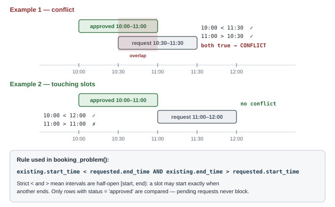
<figcaption>Figure 6.5. The overlap condition applied to the two examples. Touching slots do not conflict.</figcaption>
</figure>

Two time ranges overlap exactly when **each one starts before the other ends**:
`existing.start_time < requested.end_time AND existing.end_time > requested.start_time`.

- **10:00–11:00 vs 10:30–11:30**: 10:00 < 11:30 is true and 11:00 > 10:30 is true, so they **conflict**.
  The shared half-hour is 10:30–11:00.
- **10:00–11:00 vs 11:00–12:00**: 10:00 < 12:00 is true, but 11:00 > 11:00 is **false**, so there is **no conflict**.
  The comparisons are strict (`<`, `>`), so the implementation treats a slot as **[start, end)**: the end
  instant is free for the next booking. An automated test confirmed that an 11:00–12:00 request next to a
  10:00–11:00 approved booking is accepted.

**When conflicts are checked, and why twice.**

1. **On submission.** A request that overlaps an existing *approved* booking is refused immediately.
2. **On approval.** Pending requests may overlap each other, because a pending request is not a booking. Between
   submission and review, another overlapping request may have been approved, or the item may have broken down
   or been retired. So `reservation_approve()` repeats every check at the last possible moment.

The seed data deliberately includes such a case. Nina's pending request (11:00–13:00 on PHY-OSC-001) overlaps
Sam's approved 10:00–12:00 booking. It was inserted directly by `seed.py`, which bypasses the submission check,
so that the approval-time check can be demonstrated. Approving it shows *"This time slot overlaps an approved
reservation for the same equipment."*

### Transaction and row lock during approval {#sec-lock}

<figure>
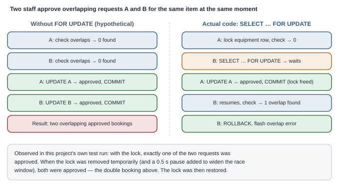
<figcaption>Figure 6.6. Why approval needs a lock: two staff approving overlapping requests at the same instant.</figcaption>
</figure>

Approval runs inside one **transaction**: `START TRANSACTION` … `COMMIT`/`ROLLBACK`. Inside it,
`SELECT … FOR UPDATE` puts an exclusive lock on the reservation row and then on the **equipment row**. A second
approval for the *same equipment* blocks on that lock until the first transaction finishes. Only then does it
run its overlap query, which now sees the first approval, so it refuses. Chapter 9 traces this step by step.

<div class="callout key" markdown="1">
**Verified, not assumed.** The project's end-to-end test script fires two approvals for overlapping requests at the
same moment from two threads. With the lock, the result was exactly one `approved` and one still `pending`. With
the lock temporarily removed and a 0.5-second pause added to widen the race window, **both** were approved: a
double booking. The code was restored afterwards. (That script was a development check kept outside the
repository; see Chapter 8.)
</div>

## Workflow D: Maintenance reporting and resolution {#sec-wf-maintenance}

<figure>
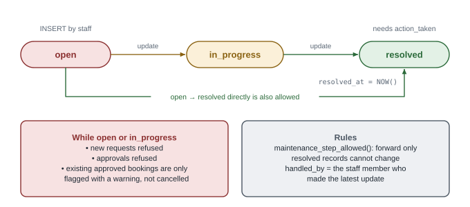
<figcaption>Figure 6.7. Maintenance states and their effect on bookings.</figcaption>
</figure>

- **Report** (`POST /maintenance`, staff/admin): inserts a new row with `status` defaulting to `open` and `reported_by`
  set to the current user. A new incident is always a **new row**, even for an item with older resolved records.
- **Update** (`POST /maintenance/<id>/update`): `maintenance_step_allowed()` permits only forward moves. Resolving
  requires `action_taken`. The `UPDATE` sets `handled_by` to the current staff member and, when resolving,
  `resolved_at = NOW()`. Resolved records cannot be changed again, and the `issue` text is never modified.
- **Effect on bookings.** While any record for an item is `open` or `in_progress`, `booking_problem()` refuses
  new requests **and** approvals for it. After resolution, an active item becomes bookable again (verified in testing).
- **Existing future bookings are flagged, not cancelled.** After reporting, `upcoming_approved_count()` counts
  approved bookings that have not ended. If there are any, staff see *"Warning: this item has N upcoming approved
  reservation(s)…"* and are taken to the item page, which has a **Cancel** button for each one. Nothing is cancelled
  or deleted automatically. The same warning appears when an admin retires an item that still has bookings.

## Workflow E: Dashboard and reports {#sec-wf-reports}

The dashboard runs **one** `SELECT` made of six scalar subqueries, plus a list of the user's next five
pending/approved reservations. Staff and admins see the four global counts; students see active equipment
and their own pending and upcoming counts.

On a freshly seeded database, the staff dashboard query returned (**real output**):

| active_equipment | pending_all | upcoming_all | open_maintenance |
|---:|---:|---:|---:|
| 9 | 3 | 2 | 2 |

The 9 is 10 items minus the retired soldering station. The 3 pending and 2 approved future bookings come from
`seed.py`. The 2 open records are the DC power supply (`open`) and the laser kit (`in_progress`).

The **Reports** page (staff/admin) runs the six queries in `reports.sql`; Chapter 7 explains each one. Two outputs
from the same seeded database (**real output**):

<div class="two-col" markdown="1">
<div markdown="1">
*equipment_by_lab_category*

| lab_name | category_name | total | active |
|---|---|---:|---:|
| Computing Lab | Computing Equipment | 2 | 2 |
| Electronics Lab | Electronics Equipment | 3 | 2 |
| Optics Lab | Optical Instruments | 2 | 2 |
| Physics Lab 1 | Measuring Instruments | 3 | 3 |
</div>
<div markdown="1">
*under_maintenance*

| equipment_name | asset_tag | open_issues |
|---|---|---:|
| He-Ne Laser Kit | OPT-LSR-001 | 1 |
| DC Power Supply | ELE-PS-001 | 1 |

Sorted by the oldest unresolved report first.
</div>
</div>

# Understanding the SQL Code {#ch-sql}

This chapter covers **only SQL**: what each statement asks MySQL to do. Chapter 8 explains the Python around it.
The queries are copied from `schema.sql`, `reports.sql` and `app.py`; "…" marks a shortened part.

## Creating the database and tables (DDL) {#sec-sql-ddl}

```sql
CREATE DATABASE IF NOT EXISTS campus_equipment;
USE campus_equipment;

DROP TABLE IF EXISTS maintenance_records;   -- children first ...
DROP TABLE IF EXISTS reservations;
DROP TABLE IF EXISTS equipment;
DROP TABLE IF EXISTS categories;            -- ... parents last
DROP TABLE IF EXISTS labs;
DROP TABLE IF EXISTS users;
```

`IF NOT EXISTS` / `IF EXISTS` make the script safe to re-run. The drop order matters: a parent table cannot be
dropped while a child table's foreign key still references it.

```sql
CREATE TABLE reservations (
    reservation_id INT AUTO_INCREMENT PRIMARY KEY,
    equipment_id   INT NOT NULL,
    user_id        INT NOT NULL,
    start_time     DATETIME NOT NULL,
    end_time       DATETIME NOT NULL,
    purpose        VARCHAR(255) NOT NULL,
    status         ENUM('pending', 'approved', 'rejected', 'cancelled', 'completed') NOT NULL DEFAULT 'pending',
    reviewed_by    INT NULL,
    created_at     DATETIME NOT NULL DEFAULT CURRENT_TIMESTAMP,
    CONSTRAINT chk_reservation_time CHECK (end_time > start_time),
    FOREIGN KEY (equipment_id) REFERENCES equipment (equipment_id) ON DELETE RESTRICT,
    FOREIGN KEY (user_id)      REFERENCES users (user_id)           ON DELETE RESTRICT,
    FOREIGN KEY (reviewed_by)  REFERENCES users (user_id)           ON DELETE RESTRICT,
    INDEX idx_reservation_slot (equipment_id, status, start_time, end_time)
) ENGINE = InnoDB;
```

| Clause | Meaning |
|---|---|
| `AUTO_INCREMENT PRIMARY KEY` | MySQL assigns 1, 2, 3 …; unique and not null |
| `NOT NULL` / `NULL` | Required vs optional value. `reviewed_by` is optional because nobody has reviewed a new request |
| `ENUM(...)` | Only the listed strings are accepted |
| `DEFAULT 'pending'` / `DEFAULT CURRENT_TIMESTAMP` | Used when an `INSERT` does not supply the column |
| `CHECK (end_time > start_time)` | Row-level rule enforced by MySQL on every insert/update |
| `FOREIGN KEY … REFERENCES … ON DELETE RESTRICT` | The value must exist in the parent; the parent cannot be deleted while referenced |
| `INDEX …` | A B-tree that speeds up lookups by these columns in this order |
| `ENGINE = InnoDB` | The storage engine that supports foreign keys, transactions and row locks |

## INSERT: adding rows {#sec-sql-insert}

```sql
INSERT INTO reservations (equipment_id, user_id, start_time, end_time, purpose)
VALUES (%s, %s, %s, %s, %s)
```

Five columns are supplied. `reservation_id`, `status` (`pending`), `reviewed_by` (NULL) and `created_at` come
from the defaults. The `%s` markers are **placeholders** filled by the driver (see *Parameterised queries*).
Other inserts follow the same pattern: users at registration, maintenance records, equipment, labs and categories,
plus everything in `seed.py`.

## SELECT with WHERE, LIKE and ORDER BY {#sec-sql-select}

```sql
SELECT user_id, password_hash FROM users WHERE email = %s
```

Login uses an equality filter on a `UNIQUE` column, so it returns at most one row and is served by the unique index.

```sql
SELECT e.equipment_id, e.asset_tag, e.equipment_name, e.status,
       c.category_name, l.lab_name, l.building, l.room_no,
       EXISTS (SELECT 1 FROM maintenance_records m
               WHERE m.equipment_id = e.equipment_id AND m.status <> 'resolved') AS under_maintenance,
       EXISTS (SELECT 1 FROM reservations r
               WHERE r.equipment_id = e.equipment_id AND r.status = 'approved'
                 AND NOW() BETWEEN r.start_time AND r.end_time) AS in_use
FROM equipment e
JOIN categories c ON c.category_id = e.category_id
JOIN labs l ON l.lab_id = e.lab_id
WHERE (e.equipment_name LIKE %s OR e.asset_tag LIKE %s) AND e.lab_id = %s   -- only filters that were used
ORDER BY e.equipment_name, e.asset_tag
```

| Part | What it does |
|---|---|
| `equipment e`, `c`, `l` | **Aliases** shorten table names |
| `JOIN categories c ON c.category_id = e.category_id` | Uses the *Category classifies Equipment* relationship to fetch the category name |
| `JOIN labs l ON l.lab_id = e.lab_id` | Uses *Lab contains Equipment* to fetch lab name, building, room |
| `LIKE %s` with value `'%osc%'` | Pattern match; `%` matches any characters, so "osc" anywhere in the name or tag matches |
| `EXISTS (subquery)` | 1 if the subquery finds at least one row, else 0. The subquery is **correlated**: it refers to the outer row `e` |
| `ORDER BY name, asset_tag` | Sorts by name, and items with the same name by tag |

The `EXISTS` subqueries are needed because the badges answer a yes/no question about *other* tables for *each*
equipment row. A plain `JOIN` would duplicate an item once for every matching maintenance record.

## INNER JOIN vs LEFT JOIN {#sec-sql-joins}

```sql
SELECT r.*, e.equipment_name, e.asset_tag, u.name AS requester, u.email, u.department,
       rv.name AS reviewer, r.end_time <= NOW() AS has_ended
FROM reservations r
JOIN equipment e ON e.equipment_id = r.equipment_id     -- every reservation has an item
JOIN users u ON u.user_id = r.user_id                   -- every reservation has a requester
LEFT JOIN users rv ON rv.user_id = r.reviewed_by         -- reviewer may be NULL
WHERE r.status = 'pending' ORDER BY r.start_time
```

`users` appears **twice** under different aliases because two different relationships are used: `u` is the
requester (`user_id`) and `rv` is the reviewer (`reviewed_by`). An **INNER JOIN** keeps only rows that have a match.
For the reviewer that would silently drop every unreviewed request. A **LEFT JOIN** keeps every reservation and fills
`rv.name` with NULL when there is no reviewer. The template shows "—" in that case. `has_ended` is a **computed column**,
a true/false value calculated per row and never stored.

## GROUP BY and aggregate functions {#sec-sql-aggregates}

```sql
-- name: equipment_by_lab_category
SELECT l.lab_name, l.building, l.room_no, c.category_name,
       COUNT(*) AS total_items,
       SUM(e.status = 'active') AS active_items
FROM equipment e
JOIN labs l ON l.lab_id = e.lab_id
JOIN categories c ON c.category_id = e.category_id
GROUP BY l.lab_id, l.lab_name, l.building, l.room_no, c.category_id, c.category_name
ORDER BY l.lab_name, c.category_name;
```

`GROUP BY` collapses all equipment rows with the same (lab, category) into one output row. `COUNT(*)` counts the
rows in each group. In MySQL a comparison such as `e.status = 'active'` evaluates to 1 or 0, so `SUM(...)` counts
only active items. This is **conditional aggregation**. For *Electronics Lab* the group holds three items, one of
them retired, giving `total 3, active 2` (real output in Chapter 6).

```sql
-- name: reservations_by_requester
SELECT u.name AS requester, u.department, e.equipment_name, e.asset_tag,
       COUNT(*) AS total_requests,
       SUM(r.status = 'approved') AS approved,
       SUM(r.status = 'completed') AS completed,
       SUM(r.status IN ('rejected', 'cancelled')) AS rejected_or_cancelled,
       MAX(r.start_time) AS latest_slot
FROM reservations r
JOIN users u ON u.user_id = r.user_id
JOIN equipment e ON e.equipment_id = r.equipment_id
GROUP BY u.user_id, u.name, u.department, e.equipment_id, e.equipment_name, e.asset_tag
ORDER BY u.name, total_requests DESC;
```

There is one output row per (requester, instrument) pair, with a count per outcome and the latest slot (`MAX`).
It works only because rejected and cancelled rows are **kept**: history makes this report possible.

```sql
-- name: most_reserved
SELECT e.equipment_name, e.asset_tag, l.lab_name,
       COUNT(r.reservation_id) AS bookings,
       COALESCE(SUM(TIMESTAMPDIFF(MINUTE, r.start_time, r.end_time)), 0) / 60 AS hours_booked
FROM equipment e
JOIN labs l ON l.lab_id = e.lab_id
LEFT JOIN reservations r ON r.equipment_id = e.equipment_id AND r.status IN ('approved', 'completed')
GROUP BY e.equipment_id, e.equipment_name, e.asset_tag, l.lab_name
ORDER BY bookings DESC, e.equipment_name
LIMIT 10;
```

Notice that the status filter is in the **`ON` clause**, not in `WHERE`. Putting it in `WHERE` would remove
equipment with no bookings, which turns the `LEFT JOIN` back into an inner join. `COUNT(r.reservation_id)`
counts only non-NULL values, so unbooked items show 0. `COALESCE(x, 0)` replaces NULL with 0, and
`TIMESTAMPDIFF(MINUTE, a, b)` gives the minutes between two datetimes. On the seed data, four items
have 1 booking (2.0 hours each) and the other six have 0.

## Subqueries and EXISTS {#sec-sql-exists}

```sql
-- name: under_maintenance
SELECT e.equipment_id, e.equipment_name, e.asset_tag, l.lab_name,
       (SELECT COUNT(*) FROM maintenance_records m
         WHERE m.equipment_id = e.equipment_id AND m.status <> 'resolved') AS open_issues,
       (SELECT MIN(m.reported_at) FROM maintenance_records m
         WHERE m.equipment_id = e.equipment_id AND m.status <> 'resolved') AS oldest_report
FROM equipment e
JOIN labs l ON l.lab_id = e.lab_id
WHERE EXISTS (SELECT 1 FROM maintenance_records m
              WHERE m.equipment_id = e.equipment_id AND m.status <> 'resolved')
ORDER BY oldest_report;
```

The `WHERE EXISTS` keeps only items with at least one unresolved record; this is the definition of "under
maintenance". The two **scalar subqueries** in the `SELECT` list each return one value per item. `status <> 'resolved'`
means "open **or** in_progress".

The dashboard uses scalar subqueries in a different way: a `SELECT` with no `FROM`, made of six independent counts.
```sql
SELECT (SELECT COUNT(*) FROM equipment WHERE status = 'active') AS active_equipment,
       (SELECT COUNT(*) FROM reservations WHERE status = 'pending') AS pending_all, …
```

## UPDATE: changing state without deleting {#sec-sql-update}

```sql
UPDATE reservations SET status = 'rejected', reviewed_by = %s
WHERE reservation_id = %s AND status = 'pending'
```

The extra `AND status = 'pending'` is a **guard**. If the row's status changed since it was read, the update
simply affects 0 rows instead of overwriting a newer decision. Cancel uses `status IN ('pending', 'approved')`,
and complete uses `status = 'approved'`.

```sql
UPDATE maintenance_records SET status = %s, action_taken = %s, handled_by = %s,
       resolved_at = IF(%s = 'resolved', NOW(), NULL)
WHERE maintenance_id = %s
```

`IF(condition, a, b)` is MySQL's inline conditional. The resolution date is set exactly when the new status is
`resolved`, which satisfies `chk_resolved_at`.

**DELETE / TRUNCATE are never used.** History is closed by changing a status. `DROP TABLE` appears only in
`schema.sql` to rebuild the schema.

## The overlap query {#sec-sql-overlap}

```sql
SELECT COUNT(*) AS n FROM reservations
WHERE equipment_id = %s AND status = 'approved' AND start_time < %s AND end_time > %s
-- parameters: (equipment_id, requested_end, requested_start)
```

The parameters are passed as `(equipment_id, end, start)`: the existing start is compared with the
**requested end**, and the existing end with the **requested start**. Only `approved` rows count. If `n > 0`, there is a
conflict. Its `WHERE` columns match `idx_reservation_slot` exactly.

## Transactions and locking {#sec-sql-transactions}

What `reservation_approve()` sends to MySQL, in order:

```sql
START TRANSACTION;
SELECT * FROM reservations WHERE reservation_id = 3 FOR UPDATE;        -- lock the request
SELECT status FROM equipment WHERE equipment_id = 2 FOR UPDATE;        -- lock the item
SELECT COUNT(*) AS n FROM maintenance_records WHERE equipment_id = 2 AND status <> 'resolved';
SELECT COUNT(*) AS n FROM reservations WHERE equipment_id = 2 AND status = 'approved'
       AND start_time < '…end…' AND end_time > '…start…';
UPDATE reservations SET status = 'approved', reviewed_by = 2 WHERE reservation_id = 3;
COMMIT;            -- or ROLLBACK; if any check failed
```

- A **transaction** groups statements so they succeed or fail **as one unit** (atomicity).
- **`COMMIT`** makes the changes permanent and visible to others, and releases the locks.
- **`ROLLBACK`** discards everything done since `START TRANSACTION` and releases the locks.
- **`SELECT … FOR UPDATE`** is a *locking read*. It takes an exclusive row lock that other `FOR UPDATE` readers and
  writers must wait for. Locking the **equipment** row puts all approvals for the same item in a single queue,
  one after another.

<div class="callout note" markdown="1">
**A subtle point that makes the lock work.** InnoDB's default isolation level is REPEATABLE READ. A plain `SELECT`
inside a transaction reads from a *snapshot*, and that snapshot is taken at the first plain (non-locking) `SELECT`.
In the approval transaction, the first plain `SELECT`s (the two `COUNT` queries) run **after** the equipment lock
has been acquired. So a waiting approval takes its snapshot only after the first approval has committed, and it
sees that approval. The concurrency test described in Chapter 6 confirms this behaviour.
</div>

`seed.py` also uses a transaction: all demo rows are inserted, then a single `commit()`. Any error triggers
`rollback()`, so the seed can never leave half the data behind.

## Session variables {#sec-sql-variables}

```sql
SET @equipment_id = 1;     -- top of reports.sql, for running it by hand
-- name: maintenance_history
… WHERE m.equipment_id = @equipment_id ORDER BY m.reported_at DESC;
```

`@equipment_id` is a MySQL **user variable**: a value that lives for the connection. The app runs
`SET @equipment_id = %s` with the selected id, then the stored query, so `reports.sql` stays runnable in the
`mysql` client without any Python placeholders.

## Parameterised queries and SQL injection {#sec-sql-params}

**SQL injection** happens when user input is pasted into SQL text and changes the statement's meaning. In this
project every value is sent separately from the SQL text:

```python
# app.py, login(): the safe pattern used everywhere in this project
user = query("SELECT user_id, password_hash FROM users WHERE email = %s",
             (request.form["email"].strip().lower(),), one=True)
```

<div class="callout limit" markdown="1">
**⚠ Unsafe counter-example. Never write this; it is NOT in the project:**
`"SELECT … FROM users WHERE email = '" + email + "'"`.
An attacker typing `' OR '1'='1` as the email would turn the condition into one that is always true.
</div>

With placeholders, the driver sends the text `' OR '1'='1` as a plain **value** to compare with, so it can never
become SQL code. `equipment_list()` builds its `WHERE` clause with an f-string, but only from **fixed** fragments
written in the code; the search text always travels in `params`.

## DBMS syllabus concepts mapped to this project {#sec-sql-map}

| Syllabus concept | Where it appears |
|---|---|
| Primary keys, surrogate keys | every `*_id INT AUTO_INCREMENT PRIMARY KEY` (`schema.sql`) |
| Candidate / composite keys | `users.email`, `equipment.asset_tag`, `categories.category_name`, `labs(building, room_no)` |
| Foreign keys, referential integrity | 8 FKs with `ON DELETE RESTRICT` (`schema.sql`) |
| NOT NULL, DEFAULT, ENUM, CHECK | all tables; `chk_reservation_time`, `chk_resolved_at` |
| Indexes | `idx_equipment_name`, `idx_reservation_slot`, `idx_maintenance_status` + automatic ones |
| CRUD (Create/Read/Update) | `INSERT`/`SELECT`/`UPDATE` throughout `app.py`; *Delete* replaced by status changes |
| WHERE, LIKE, ORDER BY, LIMIT | catalogue search, `most_reserved` |
| INNER JOIN / self-role joins | reservation lists (`users u` and `users rv`) |
| LEFT JOIN | nullable reviewer/handler, `most_reserved`, admin item counts |
| GROUP BY, COUNT, SUM, MIN, MAX | `reports.sql`, admin page |
| Subqueries, EXISTS (correlated) | catalogue badges, `under_maintenance`, dashboard |
| Transactions, COMMIT/ROLLBACK, row locks | `reservation_approve()`, `seed.py` |
| Normalisation (1NF–3NF/BCNF) | the six-table design, Chapter 4 |
| Derived vs stored data | availability via `booking_problem()`, `has_ended`, `in_use` |
| SQL injection prevention | `%s` placeholders in every query |

# Understanding the Python Code {#ch-python}

This chapter explains the **Python**: how requests are handled and how SQL is executed. The SQL itself was
explained in Chapter 7.

## Imports and configuration (`app.py:1–19`) {#sec-py-config}

```python
from flask import Flask, abort, flash, g, redirect, render_template, request, session, url_for
from werkzeug.security import check_password_hash, generate_password_hash
from db import get_connection

app = Flask(__name__)
app.config["SECRET_KEY"] = os.getenv("SECRET_KEY")      # no fallback on purpose
app.config["SESSION_COOKIE_SAMESITE"] = "Lax"

STAFF = ("lab_staff", "admin")
MAINTENANCE_ORDER = ["open", "in_progress", "resolved"]
```

`Flask(__name__)` creates the application object that every `@app.route` attaches to. Importing `db` runs
`load_dotenv()`, so `.env` values are available before `SECRET_KEY` is read. If `SECRET_KEY` is missing, Flask
refuses to create sessions instead of signing them with a guessable key.

## Database connection and cleanup {#sec-py-db}

```python
# db.py
def get_connection():
    # autocommit: each statement commits on its own; approvals open an explicit transaction.
    return mysql.connector.connect(
        host=os.getenv("DB_HOST", "localhost"),
        port=int(os.getenv("DB_PORT", "3306")),
        user=os.getenv("DB_USER", "root"),
        password=os.getenv("DB_PASSWORD", ""),
        database=os.getenv("DB_NAME", "campus_equipment"),
        autocommit=True,
    )

# app.py:58-68
def db():
    if "db" not in g:
        g.db = get_connection()
    return g.db

@app.teardown_appcontext
def close_db(_exc):
    conn = g.pop("db", None)
    if conn is not None:
        conn.close()
```

`g` is Flask's per-request storage. The first call to `db()` during a request opens a connection, later calls reuse
it, and `close_db` runs automatically when the request ends, whether it succeeded or failed. With `autocommit=True`
every single statement is committed immediately. Only approval (and seeding) groups statements with
`start_transaction()` … `commit()`/`rollback()`.

## The two query helpers (`app.py:71–89`) {#sec-py-helpers}

```python
def query(sql, params=(), one=False):
    cur = db().cursor(dictionary=True)
    try:
        cur.execute(sql, params)
        rows = cur.fetchall()
    finally:
        cur.close()
    if one:
        return rows[0] if rows else None
    return rows

def execute(sql, params=()):
    cur = db().cursor()
    try:
        cur.execute(sql, params)
        return cur.lastrowid
    finally:
        cur.close()
```

A **cursor** is the object that sends one statement and holds its results. `dictionary=True` makes each row a
`dict`, so templates can write `item.asset_tag` instead of `item[1]`. `execute(sql, params)` sends the SQL and the
values **separately** (parameter binding). `fetchall()` returns a list of rows. `try … finally` guarantees the cursor is
closed even if the query raises an error. `lastrowid` is the new `AUTO_INCREMENT` id after an `INSERT`.
`query()` is used for reading and `execute()` for writing.

## Access control: `require` and `load_user` {#sec-py-auth}

```python
def require(*roles):
    """Protect a view: any logged-in user, or only the given roles."""
    def decorator(view):
        @wraps(view)
        def wrapped(*args, **kwargs):
            if g.user is None:
                flash("Please log in first.", "warning")
                return redirect(url_for("login"))
            if roles and g.user["role"] not in roles:
                abort(403)
            return view(*args, **kwargs)
        return wrapped
    return decorator
```

**Decorators, explained.** `@require("admin")` above a function means "replace this function with `wrapped`,
which runs the checks first". `require()` with no arguments only checks that someone is logged in;
`@require(*STAFF)` unpacks the tuple into `require("lab_staff", "admin")`. `@wraps` keeps the original function's
name, which Flask needs for `url_for`. `abort(403)` stops the request and triggers the `@app.errorhandler(403)`
page. `load_user()` (`@app.before_request`) runs before *every* request and sets `g.user` from the session.

## Route reference {#sec-py-routes}

| Route | Method | Function | Access | Database work |
|---|---|---|---|---|
| `/login` | GET, POST | `login` | public | SELECT users |
| `/register` | GET, POST | `register` | public | INSERT users (role 'student') |
| `/logout` | POST | `logout` | — | none (clears session) |
| `/` | GET | `dashboard` | logged in | 6 COUNT subqueries; SELECT next 5 bookings |
| `/equipment` | GET | `equipment_list` | logged in | SELECT equipment ⋈ categories ⋈ labs + EXISTS |
| `/equipment/<id>` | GET | `equipment_detail` | logged in | item, upcoming approved, maintenance history |
| `/equipment/new` | GET, POST | `equipment_new` | admin | INSERT equipment |
| `/equipment/<id>/edit` | GET, POST | `equipment_edit` | admin | UPDATE equipment (incl. retire) |
| `/admin` | GET | `admin` | admin | labs/categories with LEFT JOIN counts |
| `/admin/labs` | POST | `add_lab` | admin | INSERT labs |
| `/admin/categories` | POST | `add_category` | admin | INSERT categories |
| `/reservations` | POST | `reservation_create` | logged in | 3 check SELECTs, INSERT reservations |
| `/reservations` | GET | `reservations` | logged in | own requests; staff also pending + approved lists |
| `/reservations/<id>/approve` | POST | `reservation_approve` | staff/admin | transaction + locks + UPDATE |
| `/reservations/<id>/reject` | POST | `reservation_reject` | staff/admin | UPDATE … 'rejected' |
| `/reservations/<id>/cancel` | POST | `reservation_cancel` | owner or staff | UPDATE … 'cancelled' |
| `/reservations/<id>/complete` | POST | `reservation_complete` | staff/admin | UPDATE … 'completed' |
| `/maintenance` | GET | `maintenance` | staff/admin | SELECT records ⋈ equipment ⋈ users |
| `/maintenance` | POST | `maintenance_report` | staff/admin | INSERT maintenance_records |
| `/maintenance/<id>/update` | POST | `maintenance_update` | staff/admin | UPDATE maintenance_records |
| `/reports` | GET | `reports` | staff/admin | the 6 queries from `reports.sql` |

**GET vs POST.** GET requests only *read* (pages, search), so they can be bookmarked and repeated safely.
Everything that *changes* data is a POST sent from a form, including logout and every reservation action.

## Important functions in detail {#sec-py-functions}

<div class="fn" markdown="1">
**`validate_slot(start, end, now)`** (`app.py:22`). *Input:* three datetimes. *Processing:* returns an error
message if a time is missing, `end <= start`, or `start <= now`; otherwise `None`. *DB:* none, which is why it is
unit-tested. *Used by:* submission and approval.
</div>

<div class="fn" markdown="1">
**`booking_problem(cur, equipment_id, start, end)`** (`app.py:137`). *Input:* an open cursor and a slot.
*Processing:* runs the three availability queries (status `FOR UPDATE`, unresolved maintenance, approved overlap)
and returns the first problem, or `None`. *Tables:* `equipment`, `maintenance_records`, `reservations` (reads only).
*Used by:* `reservation_create` (autocommit, so the lock is released at once) and `reservation_approve` (inside the
transaction, so the lock is held until commit/rollback).
</div>

<div class="fn" markdown="1">
**`reservation_create()`** (`app.py:406`). *Input:* `request.form` fields. *Processing:* `parse_datetime()` uses
`datetime.fromisoformat` on the `datetime-local` value ("2026-10-24T10:00") and returns `None` for bad input.
Then come `validate_slot`, the purpose check and `booking_problem`. *DB:* `INSERT` into `reservations`.
*Returns:* redirect to `/reservations` on success, or back to the item page with the error flashed.
</div>

<div class="fn" markdown="1">
**`reservation_approve(reservation_id)`** (`app.py:460`). *Input:* id from the URL (`<int:...>` converts it to
`int`; anything else gives 404). *Processing:* `conn.start_transaction()`, lock and re-read the reservation, check
pending/self-approval/`validate_slot`/`booking_problem`, then `UPDATE` + `commit()` or `rollback()`. The
`except Exception: conn.rollback(); raise` block makes sure an unexpected error cannot leave the transaction
open. *Returns:* redirect to `/reservations` with a flash message.
</div>

<div class="fn" markdown="1">
**`maintenance_report()` / `maintenance_update(id)`** (`app.py:561`, `584`). Report inserts a row and, if
`upcoming_approved_count()` finds future approved bookings, flashes a warning and redirects to the item page.
Update checks `maintenance_step_allowed(old, new)` (forward only), requires `action_taken` to resolve, and
updates the row (Chapter 7).
</div>

<div class="fn" markdown="1">
**`reports()`** (`app.py:605`) and **`load_reports()`** (`app.py:38`). `load_reports` reads `reports.sql` and
splits it with the regular expression `^-- name: (\w+)\n` into a `{name: sql}` dictionary. The route runs each
report through `query()` and passes the rows to `reports.html`.
</div>

## Python syntax used, explained {#sec-py-syntax}

| Syntax | Meaning in this project |
|---|---|
| `@app.route("/login", methods=["GET", "POST"])`, `@app.post("/logout")` | Connect a URL and HTTP method to the function below |
| `request.form["email"]` / `request.form.get("x", type=int)` | Read a POSTed form field (missing key with `[]` → *400 Bad Request*); `.get` returns `None` instead and converts the type |
| `request.args.get("q", "")` | Read a query-string value from a GET URL (`?q=...`) |
| `session["user_id"] = …` | Store a value in the signed session cookie |
| `g.user` | Data that lives only for the current request |
| `flash(msg, "error")` + `get_flashed_messages()` in `base.html` | One-time message shown on the next page |
| `redirect(url_for("equipment_detail", equipment_id=5))` | Build the URL from the function name and send a 302 redirect |
| `render_template("x.html", items=items)` | Fill a Jinja template with variables and return HTML |
| `try / except mysql.connector.IntegrityError / else` | Catch a constraint violation (duplicate email, asset tag, lab location); `else` runs only if no error occurred |
| `with open(path) as f:` | Context manager: the file is closed automatically |
| `(*data, status, equipment_id)` | Unpack a tuple's items into a new tuple |
| `any(m["status"] != "resolved" for m in history)` | True if at least one record is unresolved |
| `f"Warning: this item has {affected} …"` | f-string. Used only for messages and fixed SQL fragments, **never** for SQL values |

**Error handling.** `@app.errorhandler(403)` and `@app.errorhandler(404)` render `error.html`.
`@app.errorhandler(mysql.connector.Error)` logs the full exception (`app.logger.exception`) for debugging and shows a
friendly 500 page ("Check that MySQL is running and .env is correct"). Expected constraint errors (duplicates) are
caught where they happen and turned into flash messages.

**Templates (Jinja).** Every page starts with `` and fills ``.
`` loops over rows, `` hides staff-only
controls (display only; the server still checks), and `{{ r.start_time|when }}` uses the custom `when` filter
(`app.py:115`) to format dates such as "24 Oct 2026, 10:00". Jinja escapes `{{ … }}` output automatically,
so user text cannot inject HTML.

## Seed script (`seed.py`) {#sec-py-seed}

`main()` first runs `SELECT COUNT(*) FROM users`. If users exist, it prints a message and stops, which makes it
safe to run twice (verified). Otherwise, in **one transaction**, it inserts 6 users with hashed passwords,
4 labs, 4 categories and 10 equipment items (one retired). It then adds 9 reservations (2 approved, 3 pending,
2 completed, 1 rejected, 1 cancelled) and 3 maintenance records (one each of resolved, open and in progress).
Reservation times are calculated from the current hour with `timedelta`, so "upcoming" bookings are always in
the future right after seeding.

## Tests {#sec-py-tests}

`tests/test_rules.py` contains **7 `unittest` tests** in three classes:

| Test class | What it checks |
|---|---|
| `SlotValidationTest` (4 tests) | valid future slot accepted; end = start and end < start rejected; past or "now" start rejected; missing time rejected |
| `MaintenanceStepTest` (2 tests) | forward steps allowed; backward, same, unknown and `None` statuses rejected |
| `ReportsFileTest` (1 test) | `reports.sql` contains exactly the 6 report names the app uses, each a `SELECT` without a trailing `;` |

Run: `python -m unittest discover tests`. **Observed result: `Ran 7 tests … OK`** (run during preparation of
this guide).

<div class="callout note" markdown="1">
**Pure-function tests vs database tests.** The 7 unit tests call functions that never touch MySQL, so they run
anywhere in milliseconds. They **cannot** prove that joins, constraints or the transaction behave correctly. That
needs a test that drives the real app against a real database. During development an end-to-end script did this
with Flask's test client against a temporary MySQL 8.4 server: 82 checks covering roles, booking rules, all
workflows, history preservation and the concurrent-approval lock, **all passing** (re-run while preparing this
guide). That script was a development aid and is **not part of the repository**. The README's manual test checklist
covers the same ground by hand.
</div>

# One Complete Example: Browser to Database {#ch-trace}

This chapter follows **one approval** through every layer. The ids come from the seed data: reservation **3** is
Nina's pending request for *Digital Oscilloscope PHY-OSC-002* (equipment **2**), and the reviewer is
*Ravi Staff* (user **2**).

<figure class="tall">
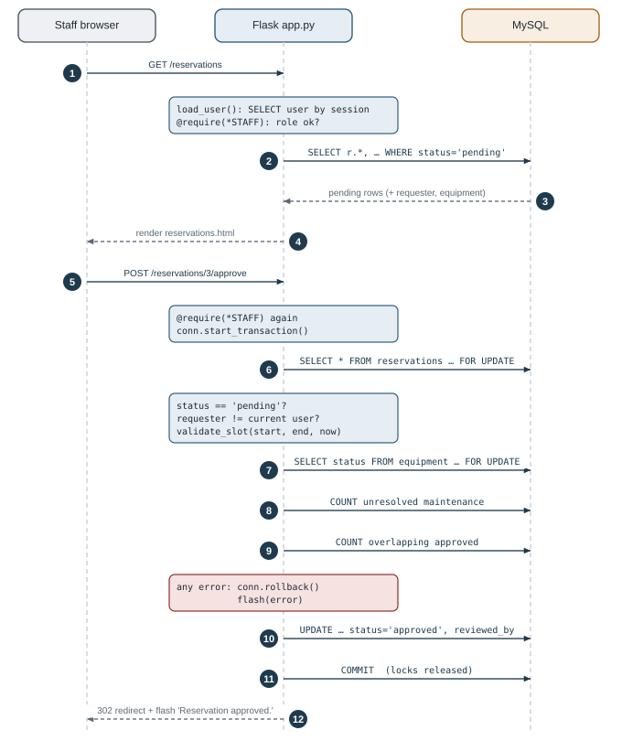
<figcaption>Figure 9.1. Sequence of an approval. Blue notes run in Python (<code>app.py</code>); arrows to MySQL are SQL statements.</figcaption>
</figure>

| # | What happens | Where | Code |
|---|---|---|---|
| 1 | Ravi opens *Reservations*; the browser sends `GET /reservations` with the session cookie | Browser → Flask | |
| — | `load_user()` reads `session["user_id"]` = 2 and loads Ravi into `g.user`; `require()` (no roles) passes | Python + 1 SQL | `app.py:107`, `92` |
| 2 | Python runs the pending-requests query (reservations ⋈ equipment ⋈ users, LEFT JOIN reviewer) | Python → MySQL | `reservations()`, `app.py:434` |
| 3 | MySQL returns the rows; the connector turns them into dictionaries | MySQL → Python | `query()` |
| 4 | Flask renders `reservations.html`. Approve/Reject buttons are shown for requests that are not Ravi's own | Python → Browser | Jinja |
| 5 | Ravi clicks **Approve**: the form POSTs to `/reservations/3/approve` | Browser → Flask | |
| — | `require("lab_staff", "admin")` checks the role **again**, because this is a new request | Python | `@require(*STAFF)` |
| — | `conn.start_transaction()` sends `START TRANSACTION` | Python → MySQL | `app.py:468` |
| 6 | `SELECT * FROM reservations WHERE reservation_id = 3 FOR UPDATE` locks and re-reads the request | MySQL | |
| — | Python checks: status is still `pending`; requester (Nina, 5) ≠ reviewer (Ravi, 2); `validate_slot()` confirms the slot is still in the future | Python | `app.py:471–476` |
| 7 | `SELECT status FROM equipment WHERE equipment_id = 2 FOR UPDATE` locks the item; status is `active` | MySQL | `booking_problem()` |
| 8 | `COUNT` of unresolved maintenance for item 2 → 0 | MySQL | |
| 9 | `COUNT` of approved reservations overlapping 11:00–13:00 → 0 | MySQL | |
| 10 | `UPDATE reservations SET status = 'approved', reviewed_by = 2 WHERE reservation_id = 3` | MySQL | `app.py:482` |
| 11 | `conn.commit()`: the change becomes permanent and visible, and both locks are released | MySQL | `app.py:484` |
| 12 | `flash("Reservation approved.")` and `redirect("/reservations")`; the browser follows it and shows the message | Flask → Browser | |

**If any check fails** (for example Nina's *other* request, reservation 2, which overlaps Sam's approved booking),
`conn.rollback()` undoes the transaction and releases the locks. The error text is flashed and nothing in the
database changes.

<div class="two-col" markdown="1">
<div class="callout sqlbox" markdown="1">
**What SQL / MySQL is responsible for**

- Storing rows permanently and returning them by key.
- Refusing invalid data: FK, UNIQUE, CHECK, ENUM, NOT NULL.
- Joining related tables and computing counts.
- Atomic transactions and row locks between users.
</div>
<div class="callout pybox" markdown="1">
**What Python / Flask is responsible for**

- Receiving HTTP requests and reading form data.
- Knowing *who* the user is (session) and what they may do.
- Business rules that span several queries: self-approval, future slot, forward-only maintenance.
- Choosing the response: page, redirect, flash message, 403.
</div>
</div>

Neither could do the job alone. MySQL does not know who is logged in or what a "staff member" may do, and Python
on its own cannot keep data safe when several users act at the same time. The approval needs **both**: Python
decides the sequence of steps, and MySQL guarantees that the sequence runs as one unit, with no other approval
able to interfere.

# Setup and Running the Application {#ch-setup}

The commands come from `README.md`. **Verified** marks steps that were actually performed on macOS while
building and documenting the project. Unmarked steps are instructions that were not run in this environment.
In particular, **no Windows command was tested**.

| Step | macOS | Windows |
|---|---|---|
| 1. Install software | Python 3.10+ and MySQL 8.0.16+ (**verified** with Python 3.11.9, MySQL 8.4.6) | same, from python.org and the MySQL installer |
| 2. Virtual environment | `python3 -m venv .venv` then `source .venv/bin/activate` (**verified**) | `py -m venv .venv` then `.venv\Scripts\Activate.ps1` (cmd: `.venv\Scripts\activate.bat`) |
| 3. Dependencies | `pip install -r requirements.txt` (**verified**) | same |
| 4. Configuration | `cp .env.example .env`, then edit `DB_PASSWORD` and `SECRET_KEY` | `copy .env.example .env`, then edit |
| 5. Start MySQL | System Settings → MySQL → Start, or `brew services start mysql` | Services → `MySQL80` → Start |
| 6. Create DB + tables | `mysql -u root -p < schema.sql` (**verified** against a local test server) | `cmd /c "mysql -u root -p < schema.sql"` (PowerShell has no `<`) or run the file in MySQL Workbench |
| 7. Demo data | `python seed.py` (**verified**, including a safe second run) | same |
| 8. Start the app | `flask --app app run` (**verified**, run with `--port 5050`) | same |
| 9. Open | <http://127.0.0.1:5000> (or the port you chose) | same |

`schema.sql` creates the database itself, so no separate `CREATE DATABASE` step is needed. The project connects
with an existing MySQL account (root by default, set in `.env`), so a dedicated MySQL user is optional.

**`.env` keys** (from `.env.example`): `DB_HOST`, `DB_PORT`, `DB_USER`, `DB_PASSWORD`, `DB_NAME`, `SECRET_KEY`.
A random key can be generated with `python -c "import secrets; print(secrets.token_hex(32))"`.

**Demo accounts** (from `README.md` and `seed.py`; local demonstration only):

| Role | Email | Password |
|---|---|---|
| Admin | `admin@campus.test` | `admin12345` |
| Lab staff | `staff@campus.test` / `meera.staff@campus.test` | `staff12345` |
| Student | `student@campus.test`, `nina@campus.test`, `karan@campus.test` | `student12345` |

The staff login and the dashboard figures in Chapter 6 were verified in a browser and by query.

## Common problems {#sec-troubleshooting}

| Symptom | Cause → fix |
|---|---|
| `Can't connect to MySQL server` (2003) | Server not running, or wrong `DB_HOST`/`DB_PORT` → start MySQL, check `.env` |
| `Access denied for user 'root'@'localhost'` (1045) | Wrong `DB_PASSWORD` in `.env` |
| `Unknown database 'campus_equipment'` (1049) / `Table … doesn't exist` | `schema.sql` not imported, or `DB_NAME` differs → step 6 |
| "The session is unavailable because no secret key was set" | `SECRET_KEY` missing from `.env` |
| `ModuleNotFoundError: No module named 'flask'` | Virtual environment not activated, or step 3 skipped |
| `Address already in use` / port 5000 busy | Another program uses the port (on macOS often *AirPlay Receiver*) → `flask --app app run --port 5050` |
| Log-in fails for demo accounts / empty pages | Seed not run → `python seed.py` |
| "Database already has users; skipping seed" | Data exists. To start over, re-import `schema.sql` (**deletes all data**), then seed |
| `CHECK` constraint ignored | MySQL older than 8.0.16 parses but ignores `CHECK` → upgrade |
| "Upcoming" demo bookings are in the past | Seed times are relative to when `seed.py` ran → re-seed shortly before a demo |

# Design Decisions, Limitations and Improvements {#ch-decisions}

## Key design decisions {#sec-decisions}

| Decision | Reason |
|---|---|
| Relational database with six tables | The data is naturally related (users, items, labs, bookings, repairs), and integrity rules are best enforced by the database |
| Primary and foreign keys everywhere | Every row is addressable, and MySQL refuses references to rows that do not exist |
| `ON DELETE RESTRICT`, no delete actions, `retired` status | Reservation and repair history is evidence; deleting a parent must never destroy or orphan it |
| Availability derived, not stored | A stored flag can drift out of sync; computing from the source records cannot |
| Role checks in the backend (`require`) | Hidden buttons protect nothing; anyone can send an HTTP request directly |
| Parameterised SQL only | Prevents SQL injection by keeping values out of the SQL text |
| Re-check plus transaction and `FOR UPDATE` on approval | Availability may change between request and review, and two staff may click at once |
| Single `users` table with `role` | Subtypes share all attributes; separate tables would add joins without new data |
| `reports.sql` as the single source of report SQL | The app and the examiner run the same queries |

## Implemented, limitations, future improvements {#sec-limits}

<div class="callout key" markdown="1">
**Implemented and verified** (unit tests, the 82-check end-to-end run, direct SQL tests, browser checks):
registration as student only; login/logout with hashed passwords; server-side role checks (403 on direct URL
access); catalogue search and filters; equipment add/edit/retire; lab and category creation with duplicate
protection; reservation request/approve/reject/cancel/complete with all eight booking rules; overlap prevention
including simultaneous approvals; maintenance report → in progress → resolved, blocking bookings while
unresolved; warnings for affected bookings; dashboard counts; six reports; history preserved; database-level
CHECK/FK/UNIQUE/ENUM enforcement.
</div>

<div class="callout limit" markdown="1">
**Limitations found during inspection**

1. **CSRF tokens are not used.** Forms rely on `SameSite=Lax` cookies, which is reasonable locally but weaker than per-form tokens.
2. **No automatic expiry.** A pending request whose start time passes stays `pending` (approval is then refused; staff can reject it), and ended approved bookings stay `approved` until staff click *Mark returned*.
3. **Partial audit trail.** `reviewed_by` records who approved or rejected, but nothing records **who cancelled** a reservation. `handled_by` and `action_taken` keep only the **latest** value.
4. **Naive local times.** `DATETIME` values have no time zone. The app (`datetime.now()`) and MySQL (`NOW()`) must run with the same clock and zone.
5. **Missing administration screens.** There is no UI to create staff/admin accounts, reset passwords, rename or remove labs/categories, or edit reservations; there is no pagination.
6. **Students cannot report faults.** Only staff/admin can create maintenance records. Maintenance can also be logged against a retired item (allowed, harmless).
7. **Light validation.** The email check is only "contains @". A missing form field returns a plain *400 Bad Request* page.
8. **Repository tests cover pure functions only.** Database behaviour was verified by a script kept outside the repository and by the manual checklist.
9. **Development server.** `flask run` (and `debug=True` when started with `python app.py`) is for local use, not public deployment.
</div>

<div class="callout note" markdown="1">
**Possible future improvements** (none of these exist yet)

- Add a `cancelled_by` column and keep handler history in the maintenance ledger, for a complete audit trail.
- A small scheduled job, or a check at page load, to expire stale pending requests.
- CSRF tokens on all forms (e.g. Flask-WTF), and an admin page to create staff accounts.
- Let students report faults, as `open` records that staff confirm.
- Move the end-to-end checks into `tests/` with a test database, so anyone can re-run them.
- Pagination and date-range filters for large reservation and maintenance histories.
</div>

# Viva Preparation {#ch-viva}

Short answers you can say aloud, with a pointer to where the evidence is in this guide.

## Project understanding {#sec-viva-project}

### Q1. What problem does the project solve?
Manual lab-equipment registers cause double bookings, unclear availability and lost repair history. Our system
keeps one database of equipment, time-slot reservations and a permanent maintenance ledger. It guarantees that
approved bookings never overlap and that broken items cannot be booked. *(Ch. 1)*

### Q2. Why did you choose this project?
It is a real campus problem, and its difficult parts are **database** problems: overlapping time intervals,
concurrent approvals, derived availability and preserved history. That let us use keys, joins, aggregates and
transactions for a reason, not just to show them off.

### Q3. What happens when someone books an instrument?
The request is validated (times, future slot, purpose), then checked against the item's status, unresolved
maintenance and overlapping **approved** bookings. If everything passes, it is stored as `pending`. Staff later
approve it inside a transaction that repeats every check. *(Fig. 6.4, Ch. 9)*

### Q4. What is the role of the maintenance ledger?
It records every fault as a separate, permanent row that moves open → in progress → resolved, with the reporter,
handler, action taken and dates. While any record for an item is unresolved, the item cannot be booked or have
bookings approved. *(Fig. 6.7)*

## DBMS concepts {#sec-viva-dbms}

### Q5. What is a primary key? Give an example.
A column, or set of columns, that uniquely identifies each row and is never NULL. `equipment.equipment_id` identifies
one physical item.

### Q6. What is a foreign key, and why use one?
A column whose value must match a primary key in another table, such as `reservations.equipment_id → equipment`.
It guarantees that every booking refers to an item that exists, and with `RESTRICT` it stops that item from being
deleted while bookings refer to it.

### Q7. What is referential integrity?
The guarantee that every foreign-key value points to an existing row. MySQL enforces it. Deleting equipment 1
failed with error 1451 because reservations reference it.

### Q8. What are candidate keys in your schema?
Column sets that could be the primary key: `users.email`, `equipment.asset_tag`, `categories.category_name`, and
the composite `labs(building, room_no)`. They are declared `UNIQUE`; the surrogate `*_id` columns are the chosen
primary keys.

### Q9. What is normalisation? Explain 1NF, 2NF and 3NF with your tables.
Normalisation organises data so that each fact is stored once. **1NF**: atomic values, with each booking as its own
row and no lists. **2NF**: no dependency on part of a key; our single-column keys make that impossible.
**3NF**: no non-key column depends on another non-key column. That is why equipment stores `lab_id`, not the lab's
name. *(Ch. 4)*

### Q10. What database constraints do you use?
`PRIMARY KEY`, `FOREIGN KEY … ON DELETE RESTRICT`, `UNIQUE` (including one composite), `NOT NULL`, `DEFAULT`,
`ENUM`, and two `CHECK`s: `end_time > start_time`, and "resolved ⇔ resolved_at is set".

### Q11. DELETE vs TRUNCATE vs DROP?
`DELETE` removes chosen rows, can use `WHERE` and can be rolled back. `TRUNCATE` empties a whole table quickly; it
cannot use `WHERE` and InnoDB refuses it on a table referenced by a foreign key. `DROP` removes the table itself.
Our project uses only `DROP TABLE IF EXISTS` in `schema.sql`; the app never deletes rows.

### Q12. INNER JOIN vs LEFT JOIN?
An INNER JOIN returns only rows that match in both tables. A LEFT JOIN returns every row from the left table and
NULLs where there is no match. We LEFT JOIN the reviewer because a pending reservation has `reviewed_by = NULL`;
an inner join would hide it. *(Ch. 7)*

### Q13. Why use GROUP BY and COUNT?
To summarise. For example, `most_reserved` counts approved/completed bookings per item, and
`equipment_by_lab_category` counts items per lab and category. `GROUP BY` forms the groups and `COUNT`/`SUM`
compute one value per group.

### Q14. What is a transaction? What do COMMIT and ROLLBACK do?
A group of statements that succeeds or fails as one unit. `COMMIT` makes the changes permanent and releases locks;
`ROLLBACK` undoes everything since `START TRANSACTION`. Approval uses one transaction for the checks and the update.

### Q15. What is SQL injection?
An attack in which input such as `' OR '1'='1` changes the meaning of an SQL statement that was built by string
concatenation. We prevent it with `%s` placeholders: values are sent separately from the SQL.

### Q16. What is an index? Which ones did you add?
A sorted structure that speeds up searches. The PK, UNIQUE and FK columns get indexes automatically. We added
`idx_reservation_slot (equipment_id, status, start_time, end_time)` for the overlap query,
`idx_maintenance_status`, and `idx_equipment_name`.

## Python and architecture {#sec-viva-python}

### Q17. Why Flask?
It is small and explicit: a URL maps to a Python function, with sessions, redirects and templates built in. That
keeps the focus on SQL instead of framework machinery. We use no ORM, so every query is visible.

### Q18. What happens in a Flask route?
Flask matches the URL and method, runs `load_user` and the `require` check, then the function reads the
form/query values, runs SQL through a cursor, and returns `render_template(...)` or a `redirect(...)`.

### Q19. GET vs POST?
GET reads and can be repeated safely (pages, search). POST submits changes (book, approve, cancel, logout).
Every data-changing action in our app is a POST.

### Q20. What is a database cursor?
The object that executes a statement on a connection and holds the results. We use `cursor(dictionary=True)` to
get rows as dictionaries, and always close it in `finally`.

### Q21. How does Python communicate with MySQL?
Through `mysql-connector-python`. `db.py` opens a connection using settings from `.env`. `cursor.execute(sql, params)`
sends the statement and the bound values over the MySQL protocol, and `fetchall()` returns the rows.

### Q22. How is the session used?
After login we store `user_id` in Flask's session, a cookie signed with `SECRET_KEY`. On each request
`load_user()` reads it and loads the user's role into `g.user`.

### Q23. Why hash passwords?
So that stolen data does not reveal passwords. A hash is one-way: we can check a typed password against it
(`check_password_hash`) but cannot recover the original. Werkzeug uses salted scrypt.

## Project-specific reasoning {#sec-viva-specific}

### Q24. How do you prevent overlapping reservations?
The overlap query `existing.start < new.end AND existing.end > new.start`, restricted to **approved** rows, runs
on request and again on approval. Approval holds a `FOR UPDATE` lock on the equipment row. *(Fig. 6.5, 6.6)*

### Q25. Is 10:00–11:00 in conflict with 11:00–12:00?
No. `11:00 > 11:00` is false, so the slots only touch. Our intervals are [start, end).

### Q26. Why is a pending reservation different from an approved one?
Pending is only a request, so pending requests may overlap each other, and only approved rows block a slot.
Staff choose which request to approve; once one is approved, the overlapping ones can no longer be approved.

### Q27. What if two staff approve conflicting requests at nearly the same time?
Both transactions try to lock the same equipment row with `SELECT … FOR UPDATE`. The second waits until the
first commits, then its overlap query finds the new approval and it rolls back. We tested this. Without the
lock, both were approved.

### Q28. What happens if an instrument has an unresolved maintenance issue?
New requests and approvals for it are refused. Existing approved bookings are **not** cancelled automatically:
staff get a warning and cancel them from the item page if needed.

### Q29. Why must permissions be checked on the backend?
Anyone can send an HTTP POST without using our pages. `require()` checks the role from the database on every
protected route, so a student posting to `/approve` gets 403.

### Q30. Why is maintenance and reservation history retained?
It is the record of who used an instrument and how it was repaired, which matters for accountability, recurring
faults and reports. Statuses close records instead of deleting them, and `RESTRICT` foreign keys make deletion of
referenced rows impossible.

### Q31. Why is there no `is_available` column?
Availability is derived from status, unresolved maintenance and approved overlaps. A stored copy would be
redundant and could contradict those facts.

### Q32. How does the app stop someone registering as admin?
The `INSERT` writes `'student'` as a literal inside the SQL; no form value is used for the role. Staff and admin
accounts come only from the seed script.

### Q33. Why does approval re-check what was already checked at request time?
The situation can change between request and review: another booking may have been approved, the item may have
broken or been retired, or the slot may now be in the past.

### Q34. What are the current limitations?
No CSRF tokens; no automatic expiry of stale requests; who cancelled a booking is not recorded and only the latest
maintenance handler is kept; local times without time zones; no admin UI for staff accounts. *(Ch. 11)*

### Q35. What does `ON DELETE RESTRICT` do, and why not `CASCADE`?
`RESTRICT` blocks deleting a parent row that is still referenced. `CASCADE` would silently delete every
reservation and repair record of a deleted item, destroying exactly the history we want to keep.

### Q36. How are the reports produced?
`reports.sql` holds six named queries. `load_reports()` splits the file at `-- name:` lines, and `/reports` runs
each query and renders the rows. The same file can also be run directly in the `mysql` client.

# Final Revision Cheat Sheet {#ch-cheatsheet}

<div class="cheat-grid" markdown="1">

<div class="cheat c-blue" markdown="1">
**Purpose in five sentences**

Colleges lose track of lab equipment, bookings and repairs. Our Flask + MySQL app catalogues every physical item
by lab and category. Users request time slots; staff approve or reject them. Approved bookings can never overlap,
and items with unresolved maintenance cannot be booked. All reservation and repair history is kept permanently.
</div>

<div class="cheat c-grey" markdown="1">
**Technologies**

Python + **Flask** (routes, sessions) · **Jinja** (HTML) · **Werkzeug** (scrypt hashes) ·
**mysql-connector-python** (cursors, `%s`) · **python-dotenv** (`.env`) · **MySQL 8 / InnoDB** (data, constraints,
locks) · HTML/CSS · **unittest**.
</div>

<div class="cheat c-orange wide" markdown="1">
**Tables, keys and relationships**

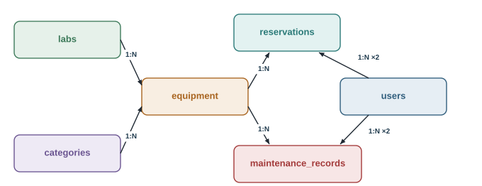

`users(user_id PK, email UQ)` · `labs(lab_id PK, UQ(building, room_no))` · `categories(category_id PK, name UQ)` ·
`equipment(equipment_id PK, asset_tag UQ, category_id FK, lab_id FK)` ·
`reservations(reservation_id PK, equipment_id FK, user_id FK, reviewed_by FK NULL)` ·
`maintenance_records(maintenance_id PK, equipment_id FK, reported_by FK, handled_by FK NULL)`.
All eight relationships are 1:N with `ON DELETE RESTRICT`.
</div>

<div class="cheat c-green" markdown="1">
**Overlap rule**

`existing.start < req.end AND existing.end > req.start`, approved rows only.
10–11 vs 10:30–11:30 → conflict. 10–11 vs 11–12 → none.
Checked on request **and** on approval (transaction + `FOR UPDATE` on equipment).
</div>

<div class="cheat c-red" markdown="1">
**Availability / maintenance rule**

Bookable ⇔ `status='active'` ∧ no record with `status <> 'resolved'` ∧ no approved overlap.
Maintenance: open → in_progress → resolved (forward only; resolving needs `action_taken`).
Existing bookings get a warning, not auto-cancelled.
</div>

<div class="cheat c-blue" markdown="1">
**Python request flow**

URL → `@app.route` → `load_user()` → `require(roles)` → read `request.form/args` → `query()/execute()` with
`%s` → `render_template()` or `flash()` + `redirect()`. Connection per request in `g`, closed by teardown.
</div>

<div class="cheat c-grey" markdown="1">
**Security principles**

Hash passwords (never store plain text) · role checks on the server · parameterised SQL · signed session +
`SameSite=Lax` · registration fixed to `student` · `SECRET_KEY` and DB password only in `.env` · Jinja auto-escaping.
</div>

<div class="cheat c-purple" markdown="1">
**SQL concepts shown**

DDL with PK/FK/UNIQUE/CHECK/ENUM/DEFAULT/INDEX · INSERT · SELECT/WHERE/LIKE/ORDER BY/LIMIT · INNER and LEFT JOIN
(two roles on `users`) · GROUP BY with COUNT/SUM/MIN/MAX · correlated EXISTS and scalar subqueries · UPDATE with
status guards · transactions, COMMIT, ROLLBACK, `FOR UPDATE`.
</div>

<div class="cheat c-orange" markdown="1">
**Run commands**

```bash
python3 -m venv .venv
source .venv/bin/activate
pip install -r requirements.txt
cp .env.example .env        # edit it
mysql -u root -p < schema.sql
python seed.py
flask --app app run
python -m unittest discover tests
```
</div>

<div class="cheat c-green wide" markdown="1">
**Ten questions to know cold**

<ol class="ten">
<li>PK vs FK, with <code>equipment_id</code> as the example</li>
<li>Why <code>RESTRICT</code>, not <code>CASCADE</code></li>
<li>1NF/2NF/3NF, and why <code>lab_name</code> is not in <code>equipment</code></li>
<li>The overlap condition and the touching-slot case</li>
<li>Why pending ≠ approved</li>
<li>Why approval re-checks inside a transaction with <code>FOR UPDATE</code></li>
<li>INNER vs LEFT JOIN (the reviewer)</li>
<li>How <code>%s</code> prevents SQL injection</li>
<li>Why availability is derived, not stored</li>
<li>Why role checks must be server-side (<code>require</code>)</li>
</ol>
</div>

</div>
